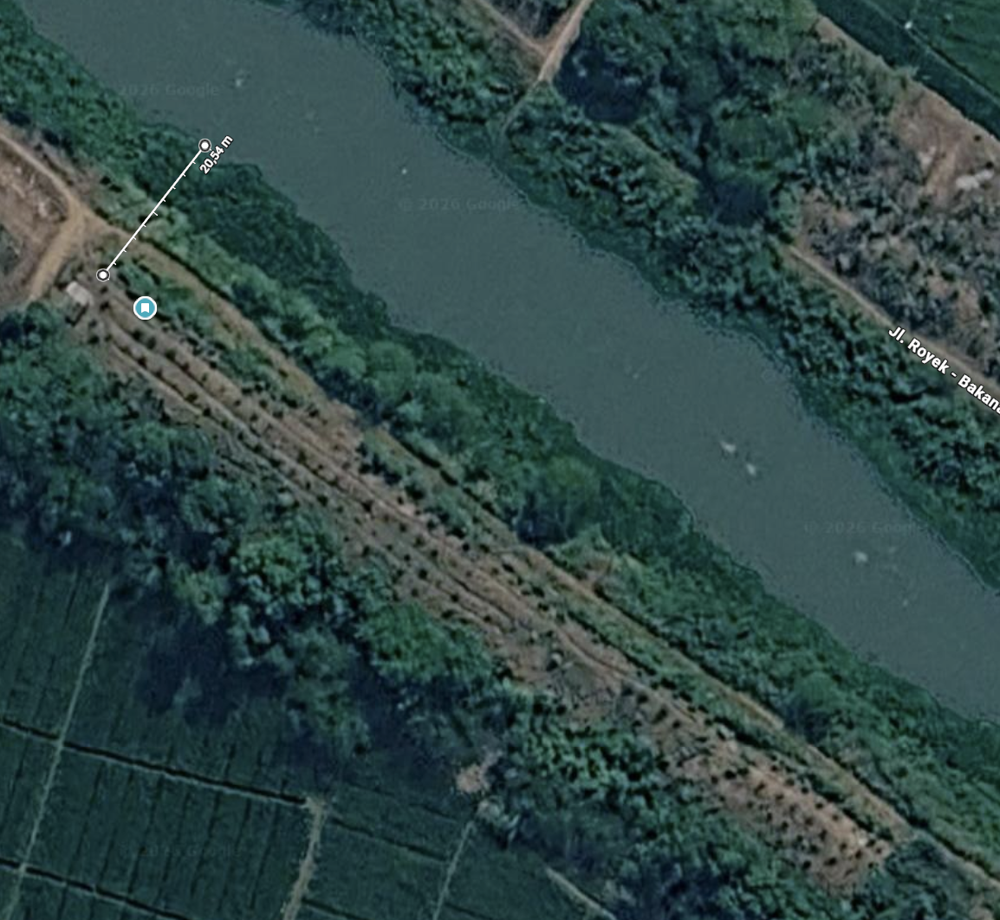

# Data Lengkap Mitra dan Kondisi Proyek Kebun Jeruk Limau

**Dihimpun 9 Oktober 2026.** Dokumen ini mengumpulkan data mitra/tim, dokumentasi lapangan, seluruh transkrip yang tersedia, perhitungan, keluhan, koreksi konteks, dan informasi yang belum diketahui dalam satu Markdown. Pembaca dapat memakai bagian awal untuk memahami proyek, lalu membuka transkrip lengkap pada bagian akhir untuk memeriksa ucapan aslinya.

Data dihimpun dari bahan yang telah diberikan pengguna. Rekaman asli Audio 1, Audio 2, dan wawancara sayuran belum tersedia; yang dibaca adalah transkrip. Foto dan citra dapat dilihat melalui tautan di dokumen ini. Video pendek merupakan berkas tersendiri. Kelengkapan di sini berarti seluruh bahan teks dan data proyek yang tersedia dalam sesi ini dihimpun, bukan seluruh keadaan kebun sudah diukur.

## Daftar isi

- [Ringkasan dan status data](#ringkasan-dan-status-data)
- [Identitas dan lokasi](#identitas-dan-lokasi)
- [Daftar sumber dan asal informasi](#daftar-sumber-dan-asal-informasi)
- [Lahan dan geometri jaringan parit](#lahan-dan-geometri-jaringan-parit)
- [Tanaman dan praktik budidaya jeruk](#tanaman-dan-praktik-budidaya-jeruk)
- [Alur air dan pekerjaan penyiraman](#alur-air-dan-pekerjaan-penyiraman)
- [Energi pompa dan keluhan perawatan](#energi-pompa-dan-keluhan-perawatan)
- [Biaya dan kebutuhan mitra](#biaya-dan-kebutuhan-mitra)
- [Perhitungan dan estimasi bersyarat](#perhitungan-dan-estimasi-bersyarat)
- [Peta pembahasan Audio 1](#peta-pembahasan-audio-1)
- [Peta pembahasan Audio 2](#peta-pembahasan-audio-2)
- [Kebun sayuran milik mitra yang sama](#kebun-sayuran-milik-mitra-yang-sama)
- [Masalah yang perlu dianalisis](#masalah-yang-perlu-dianalisis)
- [Hal yang belum diketahui dan pemeriksaan berikutnya](#hal-yang-belum-diketahui-dan-pemeriksaan-berikutnya)
- [Koreksi penting dan batas penggunaan data](#koreksi-penting-dan-batas-penggunaan-data)
- [Kajian dan gagasan yang dibahas setelah wawancara](#kajian-dan-gagasan-yang-dibahas-setelah-wawancara)
- [Dokumentasi visual dan tanggal](#dokumentasi-visual-dan-tanggal)
- [Hubungan dengan laporan dan konteks AI](#hubungan-dengan-laporan-dan-konteks-ai)
- [Transkrip lengkap Audio 1 dan Audio 2](#transkrip-lengkap-audio-1-dan-audio-2)
- [Transkrip lengkap wawancara kebun sayuran](#transkrip-lengkap-wawancara-kebun-sayuran)

## Ringkasan dan status data

Proyek berfokus pada kebun jeruk limau di tepi sungai/saluran irigasi di Ciberes, Subang. Air dipompa ke tiga parit galian tanah yang saling terhubung, kemudian pekerja mengambil air dengan ember kecil dan mengguyurkannya ke tiap pohon. Parit telah mendekatkan air ke tanaman, tetapi tahap pemberian air masih manual dan belum memiliki catatan volume per pohon.

Menurut mitra/tim, terdapat sekitar **500–600 pohon**, banyak di antaranya diperkirakan setinggi **sekitar 1 m**. Penyiraman sekitar **tiga hari sekali** melibatkan **empat pekerja dengan upah Rp100.000 per orang per kegiatan**, sehingga upahnya **Rp400.000/kegiatan**. Mitra menyebut acuan minimal **15 L/pohon setiap penyiraman**, tetapi pemberian aktual belum diketahui dan angka itu belum menjadi dosis agronomis tervalidasi.

Mitra ingin pekerjaan guyur manual dapat digantikan agar biaya turun dan pemberian air lebih terjamin. Kebutuhan biaya diperjelas tim sebagai biaya total tahun pertama yang lebih rendah daripada praktik eksisting pada periode/cakupan sebanding. Kebun belum tersambung PLN. Pompa bensin dilaporkan dimodifikasi memakai LPG untuk menekan biaya bahan bakar, disertai keluhan panas, kerusakan, dan perawatan.

Gunakan status berikut ketika membaca tabel dan transkrip:

| Status | Artinya |
|---|---|
| Keterangan mitra | Ucapan dalam transkrip; belum otomatis menjadi hasil ukur atau diagnosis. |
| Klarifikasi tim/pengguna | Penjelasan dan koreksi konteks yang diberikan dalam percakapan. |
| Observasi visual | Hal yang terlihat pada foto/citra; kemampuannya terbatas pada yang tampak. |
| Perhitungan bersyarat | Hasil aritmetika dari data/asumsi; belum merupakan pemakaian atau biaya aktual. |
| Literatur/kajian | Prinsip pembanding; kondisi percobaan lain tidak langsung menjadi dosis/kinerja kebun. |
| Belum diketahui | Data belum tersedia atau belum cukup jelas untuk ditetapkan. |

## Identitas dan lokasi

| Data | Keterangan dan sumber |
|---|---|
| Komoditas proyek | Jeruk limau menurut mitra/tim; identitas spesies, varietas, batang bawah, dan asal bibit belum dikonfirmasi. |
| Nama usaha/pengelola | Belum diberikan untuk dicantumkan; tidak dibuat nama pengganti. |
| Lokasi | JH7H+222, Ciberes, Kabupaten Subang, Jawa Barat; keterangan pengguna, bukan hasil survei koordinat tim. |
| Posisi umum | Kebun memanjang di tepi sungai/saluran irigasi menurut keterangan dan citra yang diberikan. |
| Institusi | S1 Teknik Komputer, Fakultas Teknik Elektro, Universitas Telkom. |
| Anggota | Muhammad Al Qarnie — 101032330043; Maheswara Ariq Athallah — 101032300050; Daffa Hermansyah — 101032330090. |
| Pembimbing 1 | Dr. Agung Nugroho Jati, S.T., M.T. |
| Pembimbing 2 | Belum diberikan. |
| Tahap | CD-1: analisis masalah/kebutuhan, kompleksitas, dan pendekatan yang telah tersedia. |
| Hasil bimbingan yang dilaporkan | Pengguna sudah bimbingan; arahan memperdalam masalah, termasuk tanah, serta mempertimbangkan robot berselang. Tanggal pasti/jumlah sesi belum tersedia. |

## Daftar sumber dan asal informasi

Kode di tabel berikut hanya penanda dalam dokumen ini, terpisah dari nomor sitasi IEEE CD-1.

| Kode | Sumber | Konteks dan keterbatasan |
|---|---|---|
| A1 | Audio 1 dalam [transkrip asli yang tersedia](../sumber/dokumentasi/wawancara/Transkrip_Audio_1_dan_2.txt) | Sumber utama penuturan mitra tentang tapak proyek. Transkrip sampai 07:16; durasi rekaman asli dan tanggalnya belum dikonfirmasi. |
| A2 | Audio 2 dalam berkas transkrip yang sama | Tambahan yang berpindah antara kebun belakang rumah dan rujukan kebun luas. Transkrip sampai 09:47. Konteks lokasi harus diperiksa per bagian. |
| U | Klarifikasi pengguna/tim dalam percakapan proyek | Populasi, upah penyiraman, geometri tiga parit/penghubung, lebar kebun, tanggal video, pemisahan lokasi, serta tujuan biaya. Riwayat percakapan asli tidak seluruhnya diekspor ke repo; poin relevannya dihimpun di sini dan konteks AI. |
| P1 | [Foto parit 211212](../sumber/dokumentasi/foto/Screenshot%202026-10-05%20211212.png) | Menunjukkan saluran tanah terbuka di antara tanaman; tanggal pemotretan belum dikonfirmasi. |
| P2 | [Foto tanaman dan parit 211238](../sumber/dokumentasi/foto/Screenshot%202026-10-05%20211238.png) | Mendukung bentuk saluran dan kondisi visual tanaman; bukan pengukuran dimensi atau kesuburan. |
| P3 | [Kolase dua foto](../sumber/dokumentasi/foto/Kolase_Parit_Tanah.png) | Penyajian ulang foto; tidak dihitung sebagai pengamatan lapangan tambahan yang independen. |
| C1 | [Citra garis 117,52 m](../sumber/dokumentasi/citra/Screenshot%202026-10-05%20204359.png) | Satu garis ukur koridor kebun; tanggal citra dan batas bidang belum dikonfirmasi. |
| C2 | [Citra garis 20,54 m](../sumber/dokumentasi/citra/Jarak_Menuju_Sungai_20_54m.png) | Jarak tampak atas menuju badan air; bukan beda elevasi atau head pompa. |
| V | [Video pendek kondisi kebun](../sumber/dokumentasi/video/WhatsApp%20Video%202026-10-05%20at%2021.16.41.mp4) | Sekitar 19 detik; pengguna mengonfirmasi pengambilan **3 Oktober 2026**. Nama berkas mencantumkan 5 Oktober, bukan tanggal pengambilan. |
| L | [Foto permukiman 003940](../sumber/dokumentasi/lokasi-lain/Screenshot%202026-10-06%20003940.png) | Lokasi lain; kabel terlihat pada lingkungan rumah. Tidak membuktikan tapak jeruk terhubung PLN. |
| S | Transkrip wawancara kebun terong/kembang kol, direproduksi lengkap pada bagian akhir | Mitra sama, lokasi berbeda sekitar 500 m–1 km menurut pengguna. Tidak memiliki timestamp; tanggal rekaman belum dikonfirmasi. Lampiran teks diterima dalam percakapan 8 Oktober 2026. |

Sumber asli S berada pada lampiran lokal `C:/Users/daffa/.codex/attachments/cf4160ee-9b1a-414b-81cd-3b2b0be40a32/Pasted text.txt`. Isi transkripnya tersedia di akhir MD ini agar tetap dapat dibaca saat berpindah komputer. Ini reproduksi teks yang diberikan, bukan verifikasi audio.

Sumber akademik pendamping meliputi [template CD-1](../sumber/template/FTE-CD-1_edited-PBD.docx), [buku panduan capstone](../sumber/panduan/bukupanduancapstone_2024signed.pdf), [jadwal/rubrik PTA](../sumber/rubrik-jadwal/Jadwal_PTA%20--%20Rubrik%20PTA%20--%202627%20%281%29.pdf), serta [laporan riset terdahulu](../sumber/riset/deep-research-report.md). Keempatnya bukan hasil pengukuran kebun. Rancangan pada riset terdahulu belum menjadi keputusan tim. [Manifest sumber](../sumber/MANIFEST.json) adalah snapshot perakitan 8 Oktober 2026; entri DOCX/PDF di dalamnya bukan checksum versi aktif setelah revisi berikutnya.

## Lahan dan geometri jaringan parit

| Parameter | Data tersedia | Dasar dan batas |
|---|---|---|
| Bentuk umum kebun | Memanjang dekat irigasi | U, C1/C2; belum peta bidang terukur. |
| Jumlah parit memanjang | Tiga | U; foto memperlihatkan saluran, tidak digunakan sendirian untuk menghitung seluruh jaringan. |
| Panjang tiap parit | Sekitar 100 m | U; perkiraan, belum survei setiap parit. |
| Posisi parit | Di sisi kanan deretan pohon menurut penjelasan pengguna | U; orientasi arah mata angin dan tata letak lengkap belum dipetakan. |
| Penghubung | Ada parit melintang setiap beberapa pohon | U; jarak/frekuensi penghubung belum diukur. |
| Pertemuan saluran | Dapat berbentuk “+” | U; menunjukkan ketiga parit saling terhubung. |
| Bahan/konstruksi | Galian tanah terbuka, tanpa lapisan beton pada foto | P1/P2, U; bukan pipa atau konstruksi otomatis. |
| Kedalaman | Disebut kurang dalam | U/A1; belum angka kedalaman atau penampang. |
| Tinggi air | Pengambilan sulit ketika dangkal | Keterangan mitra/tim; belum pengukuran tinggi dan simpanan air. |
| Lebar kebun | Kurang lebih 6 m | U; belum lebar bidang atau lebar jalur bebas robot yang terukur. |
| Garis koridor | 117,52 m | C1; satu garis pada citra, tidak disamakan dengan panjang pasti tiap parit. |
| Jarak menuju sungai | 20,54 m | C2; tampak atas, bukan head, panjang selang nyata, atau beda elevasi. |
| Luas total kebun jeruk | Belum terverifikasi | Batas bidang dan cakupan 500–600 pohon belum dipetakan. |
| Jarak tanam/jumlah baris | Belum diketahui | Tidak diturunkan dari foto atau perkiraan lebar. |
| Elevasi/kemiringan | Belum diketahui | Memerlukan pengukuran lapangan. |
| Posisi inlet/outlet pompa | Belum dipetakan lengkap | Pernah dibahas titik/stasiun pada sketsa, tetapi belum dasar posisi final. |

Garis 117,52 m, lebar sekitar 6 m, dan populasi 500–600 pohon belum dipastikan mencakup bidang yang sama secara lengkap. Karena itu, perkalian panjang dan lebar tidak dicatat sebagai luas seluruh kebun. Cakupan koridor, pohon yang dilayani, dan batas lahan perlu diperiksa bersama.

Hubungan parit menurut klarifikasi tim:

```text
Parit 1  ───────┼──────────┼──────────
                │          │
Parit 2  ───────┼──────────┼──────────
                │          │
Parit 3  ───────┼──────────┼──────────
```

Sketsa di atas memperlihatkan keterhubungan, tanpa menetapkan skala, arah aliran, jarak penghubung, atau arah mata angin. Tiga parit tidak langsung berarti tiga pompa, tiga kontroler, atau tiga zona.

## Tanaman dan praktik budidaya jeruk

| Hal | Keterangan tersedia | Dasar dan batas |
|---|---|---|
| Populasi | Sekitar 500–600 pohon | U; A2 02:42–02:51 juga menyebut 600 pohon. Belum sensus. |
| Tinggi | Banyak pohon diperkirakan sekitar 1 m | U; bukan tinggi rata-rata hasil ukur dan bukan bukti umur. |
| Tajuk/akar | Belum ada ukuran | Foto tidak menetapkan diameter tajuk atau kedalaman akar. |
| Umur dan tahun tanam | Belum dikonfirmasi | Ucapan 14 bulan pada A2 tidak dijadikan umur kebun proyek. |
| Fase bunga/buah | Belum ada catatan per kelompok pohon | Tidak ditentukan hanya dari foto atau ungkapan “kalau sudah berbuah”. |
| Harapan pertumbuhan | Mitra mengaitkan air dengan pertumbuhan normal dan buah lebat | A1 02:11–02:32 dan 06:15–06:21; pendapat mitra, bukan hasil uji sebab-akibat. |
| Acuan air | Minimal 15 L tiap pohon setiap penyiraman | A1 02:24–02:32, U; A2 memiliki koreksi ucapan hari/interval. |
| Pemberian aktual | Mitra merasa kurang dari acuan; liter belum diketahui | A1 03:04–03:06, A2 02:24–02:30, U; belum persentase kekurangan. |
| Pemupukan | Dua kali setahun, awal kemarau dan awal hujan | A1 06:23–06:28; tanggal aktual dan jenis belum tersedia. |
| Jumlah pupuk yang disebut | “1 kuintal lebih” | A1 06:34–06:40; pertanyaan menyebut konsumsi pupuk “di sini”, mitra menjawab jumlah tersebut. Cakupan pohon, satu kali aplikasi atau periode lain, serta jenis pupuk belum jelas. Tidak menjadi dosis per pohon atau per hektar. |
| Rencana pupuk berikutnya | Menjelang musim hujan | A1 06:29–06:31; rencana saat percakapan, bukan catatan pekerjaan telah selesai atau tanggal kalender. |
| Pestisida | Sekitar seminggu sekali untuk pencegahan hama | A1 06:43–06:52; produk, konsentrasi, dosis, luas cakupan, dan pelaksanaan aktual belum dicatat. |
| Keluhan hama jeruk | Mitra mengatakan hama pada pohon seperti itu tidak begitu sulit dan pestisida murah masih dapat dipakai | A1 01:49–02:08; bukan identifikasi spesies hama atau uji efektivitas. |
| Pekerjaan panen | Ucapan empat orang mendapat sekitar 10–15 pohon, dengan kesulitan memetik pohon tinggi | A1 00:04–00:15; durasi tidak jelas. Konteks **memetik**, bukan produktivitas menyiram. |
| Produksi/hasil jeruk | Belum ada angka panen tervalidasi | Angka ton pada wawancara sayuran dan “9 ton” pada diskusi volume air tidak dijadikan panen jeruk. |
| Bukti kerugian buah akibat air | Belum tersedia | Belum catatan ukuran buah, gugur, hasil, atau kualitas yang menguji penyebabnya. |

Satu kuintal setara 100 kg secara satuan. Akan tetapi, ungkapan “1 kuintal lebih” tetap tidak memberikan berat pasti atau dasar pembagian dosis untuk 500–600 pohon. Keterangan ini disimpan untuk ditanyakan lagi kepada mitra.

## Alur air dan pekerjaan penyiraman

```text
Sungai / saluran irigasi
          ↓
Pompa mesin eksisting
          ↓
Tiga parit tanah yang terhubung melintang
          ↓
Pekerja mengambil air memakai ember hitam kecil
          ↓
Air diguyurkan manual ke setiap pohon
```

| Hal | Keterangan | Sumber/status |
|---|---|---|
| Sumber air utama | Sungai/saluran irigasi dekat kebun | U; A2 03:05–03:28 merujuk kebun luas. |
| Fungsi pompa | Menaikkan/mengalirkan air ke kebun dan parit | A1/A2, U; spesifikasi dan debit belum diketahui. |
| Fungsi parit | Mendekatkan air agar pekerja mudah mengambilnya | Koreksi U; galian tanah dipilih sebagai sarana sederhana/hemat. |
| Cara pemberian akhir | Menimba lalu mengguyur memakai ember kecil | A1 00:31–00:39, A2 03:17–03:28, U. |
| Warna/ukuran wadah | Ember hitam kecil menurut pengguna | U; kapasitas liter belum diukur. |
| Jumlah guyuran | Beberapa ember/guyuran menurut pengguna | U; bukan angka pasti per pohon. |
| Interval | Sekitar tiga hari sekali | U dan A2 02:20–02:24; jadwal musim/hujan belum dicatat. |
| Ketelitian volume | Belum ada catatan volume per pohon | Data awal; kapasitas, tingkat isi, tumpahan, dan jumlah guyuran belum diketahui. |
| Keadaan setelah pompa berhenti | Mitra menyebut air kering/habis; “bekas pagi ini” | A1 02:36–02:44; waktu penurunan dan penyebab belum diukur. |
| Otomasi yang sudah berjalan | Belum dilaporkan | Guyuran tetap manual; penggalian parit bukan otomasi. |
| Pembagian pekerjaan | Belum tersedia | Belum diketahui siapa mengoperasikan pompa, merawat parit, berjalan, dan mengguyur. |

A1 02:45–03:23 juga membahas biaya selang, beton, dan paralon sebagai pertimbangan pembuatan saluran. Klarifikasi pengguna menetapkan rumusan tujuan parit: memudahkan pengambilan air dekat pohon melalui galian yang hemat. Pembahasan itu tidak digunakan untuk menyatakan biaya upah sudah turun akibat otomatisasi.

Berkurangnya air dapat berkaitan dengan pengambilan pekerja, infiltrasi, aliran keluar, dan penguapan. Bagian yang meresap dekat akar mungkin ikut tersedia bagi tanaman. Besar masing-masing belum diukur; belum ada angka kehilangan air atau efisiensi kebun.

## Energi pompa dan keluhan perawatan

| Hal | Keterangan | Batas penggunaan |
|---|---|---|
| PLN | Tidak ada karena jauh | A1 05:08–05:11 dan U; jarak kabel serta biaya sambungan belum diketahui. |
| Mesin semula | Memakai bensin/BBM | A1 01:28–01:38 dan 03:52–03:57. |
| Modifikasi | Bahan bakar diubah memakai gas/LPG tabung 3 kg | A1 03:57–04:53; detail instalasi dan keselamatan teknis belum diperiksa. |
| Alasan modifikasi | Menekan biaya bahan bakar dibanding bensin | U dan percakapan A1; tidak ada perbandingan rupiah/liter atau rupiah/kegiatan. |
| Keluhan panas | Mesin disebut terlalu panas | A1 04:20–04:22; belum pengukuran suhu atau diagnosis. |
| Komponen | Mitra menyebut seher/ring cepat habis serta umur pakai pompa lebih rendah | A1 04:11–04:31; tanpa catatan servis atau inspeksi. |
| Perawatan | Disebut boros/cepat rusak | A1 04:53–05:04; biaya, frekuensi, dan downtime belum tersedia. |
| Bahan bakar anjuran | Mitra menyebut Pertalite/Pertamax dari pembuat mesin | A1 04:33–04:40; manual produsen belum diberikan. |
| Spesifikasi pompa | Model, daya, debit, head, dan efisiensi belum tersedia | Jangan membuat spesifikasi dari citra atau nama “alkon”. |
| Catatan operasi | Konsumsi LPG, lama hidup, dan energi per penyiraman belum tersedia | Penghematan biaya total belum dapat dihitung. |

Ucapan peserta tentang subsidi LPG pada A1 04:06–04:10 dipertahankan dalam transkrip. Itu komentar peserta; dokumen ini tidak menetapkan pelanggaran hukum atau memberikan penilaian legal.

Pada A1 01:28 ada ucapan yang dikoreksi sendiri dari “listrik” menjadi “bensin”. Pembacaan kondisi tapak memakai penjelasan berikutnya dan klarifikasi pengguna bahwa kebun proyek belum memiliki PLN. Kebun lain yang dekat listrik/air tanah pada A1 05:15–06:08 tidak digunakan sebagai kondisi kebun proyek.

## Biaya dan kebutuhan mitra

| Hal | Data/kebutuhan | Status |
|---|---|---|
| Pekerja penyiraman | Empat orang | Klarifikasi U; tidak semata-mata diambil dari ucapan empat pemetik pada awal A1. |
| Tarif | Rp100.000 per orang per kegiatan | U; bukan tarif per jam atau tarif seluruh kelompok. |
| Upah satu penyiraman | Rp400.000 | Perhitungan dari tarif dan jumlah pekerja. |
| Keluhan | Biaya penyiraman/operasi air besar dan berulang | Penuturan mitra, termasuk A2 00:33–00:51. Proporsi terhadap seluruh biaya belum dibukukan. |
| Biaya kumulatif | Sekitar Rp90 juta sejak pembukaan lahan sampai kondisi saat kunjungan | A1 00:51–01:16; cakupan rinci/periode tepat belum tersedia. Bukan biaya bulanan atau penyiraman saja. |
| Sasaran pekerjaan | Menggantikan pengambilan dan guyuran manual agar biaya pekerja turun | Penegasan U tentang kebutuhan mitra. Tidak otomatis berarti seluruh pekerja diberhentikan. |
| Sasaran air | Air tiap pohon lebih terjamin dan dapat diperiksa | U; pencapaian acuan 15 L belum terukur. |
| Target tahun pertama | Biaya total penyiraman lebih rendah daripada praktik eksisting | Diperjelas U; perbandingan periode, cakupan pohon, dan kebutuhan air harus sebanding. |
| Komponen pendekatan baru | Alat, instalasi, energi/bahan bakar, perawatan, dan upah tersisa | Cakupan analisis biaya; nominal belum ditetapkan. |
| Komponen pembanding | Upah, bahan bakar, perawatan, dan penggantian sarana bila diperlukan | Cakupan praktik eksisting pada periode pembanding. |
| Anggaran alat | Belum tersedia | Rp48,7 juta/tahun bukan anggaran alat. |

Pengurangan biaya belum boleh dihitung sebagai hilangnya seluruh Rp400.000/kegiatan. Tugas menyiapkan air, memelihara saluran/perangkat, mengawasi, atau mengisi energi mungkin masih diperlukan. Pembagian waktu dan pekerjaan perlu diketahui dahulu.

## Perhitungan dan estimasi bersyarat

Semua angka pada bagian ini adalah aritmetika/skenario. Acuan volume, frekuensi, dan populasi belum menjadi pemakaian aktual atau kebutuhan tanaman yang diuji.

| Besaran | Perhitungan | Hasil | Asumsi/batas |
|---|---|---|---|
| Upah/kegiatan | 4 × Rp100.000 | Rp400.000 | Tarif per orang per kegiatan. |
| Kegiatan/30 hari | 30 ÷ 3 | Sekitar 10 | Interval tetap, tanpa penyesuaian hujan. |
| Upah/30 hari | 10 × Rp400.000 | Rp4.000.000 | Upah saja, tanpa bahan bakar/perawatan. |
| Frekuensi tahunan rata-rata | 365 ÷ 3 | Sekitar 121,67 | Dasar estimasi, bukan jumlah kegiatan pecahan yang benar-benar dikerjakan. |
| Upah tahunan rata-rata | (365 ÷ 3) × Rp400.000 | Sekitar Rp48,7 juta | Interval tetap; belum pengeluaran aktual. |
| Jadwal tahunan bulat | 121 atau 122 kegiatan × Rp400.000 | Rp48,4–48,8 juta | Jumlah bergantung tanggal kegiatan pertama. |
| Volume nominal/kegiatan | 500–600 × 15 L | 7.500–9.000 L = 7,5–9 m³ | Semua pohon diasumsikan menerima acuan mitra. |
| Volume nominal/30 hari | 10 × 7,5–9 m³ | 75–90 m³ | Sepuluh kegiatan skenario. |
| Upah/pohon/kegiatan | Rp400.000 ÷ 600 sampai ÷ 500 | Sekitar Rp667–800 | Pembagian upah terhadap perkiraan populasi. |
| Rata-rata acuan air/hari | 15 L ÷ 3 hari | 5 L/hari | Kesetaraan aritmetika; bukan anjuran menyiram 5 L setiap hari. |
| Contoh waktu keluaran berurutan | 7.500–9.000 L ÷ 10 L/menit | 750–900 menit = 12,5–15 jam | Debit 10 L/menit adalah contoh kajian, bukan hasil ukur pompa. Belum waktu gerak/pengisian. |

Air keluar pompa, air dalam parit, air yang diguyurkan, dan air tersedia bagi akar adalah besaran berbeda. Volume nominal 7,5–9 m³ belum menjadi volume yang dipompa, debit, jumlah yang benar-benar diterima pohon, atau dasar memilih pompa/pipa.

Belum ada dasar untuk menghitung luas total, volume simpanan parit, efisiensi, biaya bahan bakar, biaya perawatan, penghematan persentase, atau masa balik modal. Variabel yang diperlukan belum tersedia.

## Peta pembahasan Audio 1

| Waktu | Isi | Cara menggunakan |
|---|---|---|
| 00:00–00:15 | Sirkulasi harian dan empat pekerja mendapat 10–15 pohon; kesulitan memetik saat tinggi | Bagian awal terpotong; angka produktivitas berkaitan dengan pemetikan. |
| 00:31–00:39 | Menampung air lalu menimba ember | Mendukung praktik manual; belum volume wadah. |
| 00:51–01:16 | Biaya sekitar Rp90 juta dari pembukaan lahan | Biaya kumulatif tanpa rincian. |
| 01:28–01:38 | Bensin dan keluhan biaya bahan bakar | Sumber energi eksisting; bukan nilai pemakaian aktual. |
| 01:49–02:08 | Hama dianggap relatif tidak sulit; pestisida murah | Persepsi mitra; bukan hasil identifikasi/uji. |
| 02:11–02:32 | Pertumbuhan normal/buah lebat dan acuan sekali siram 15 L | Acuan mitra, belum dosis agronomis. |
| 02:36–02:44 | Air parit kering sendiri setelah pemompaan | Keluhan ketersediaan; penyebab belum dipisahkan. |
| 02:45–03:23 | Selang, galian parit, beton/paralon, dan kemudahan/biaya | Dipadukan dengan koreksi pengguna tentang tujuan parit. |
| 03:28–03:51 | Peserta menyatakan masalah utama air dan mempertanyakan listrik | Diskusi arah proyek, belum rancangan. |
| 03:52–05:04 | Modifikasi bensin ke LPG; panas, seher/ring, perawatan | Keluhan teknik tanpa diagnosis. |
| 05:08–05:11 | Tidak ada listrik karena jauh | Kendala tapak proyek. |
| 05:15–06:08 | Kebun lain lebih kecil, dekat listrik, kemungkinan air tanah | Tidak dipindahkan ke tapak jeruk proyek. |
| 06:15–06:21 | Mitra mengaitkan penyiraman dengan pertumbuhan | Penilaian mitra, belum hubungan kausal yang diuji. |
| 06:23–06:31 | Pupuk dua kali setahun dan rencana menjelang hujan | Praktik dan rencana; tanggal aplikasi belum diketahui. |
| 06:34–06:40 | Konsumsi pupuk “1 kuintal lebih” | Simpan ucapan; perlu konfirmasi cakupan/periode. |
| 06:43–06:52 | Pestisida seminggu sekali untuk pencegahan | Produk/dosis serta pelaksanaan belum diperiksa. |
| 06:53–07:16 | Ajakan ke kebun sayuran dan memeriksa pompa | Menguatkan adanya lokasi lain; perjalanan bukan data dimensi. |

## Peta pembahasan Audio 2

| Waktu | Isi | Konteks/batas |
|---|---|---|
| 00:00–00:32 | Tanaman tahunan dibanding sayuran musiman; biaya minimal 14 bulan | Penuturan umum; bukan umur pasti kebun atau jadwal panen terukur. |
| 00:33–00:51 | Pengairan disebut kendala/biaya terbesar | Persepsi mitra; belum rincian pembukuan. |
| 00:58–01:43 | Bekas empang/pembuangan sampah, urukan, dugaan simpanan air | **Kebun belakang rumah**, dipisahkan menurut klarifikasi U. |
| 01:56–02:09 | Memilih fokus air, penyiraman, atau hama | Diskusi, belum keputusan desain. |
| 02:09–02:30 | Acuan 15 L dari bacaan mitra; ucapan “satu hari” lalu “per tiga hari” | Keterangan tidak konsisten; formulasi proyek memakai per penyiraman/±3 hari dari A1 dan U. Bacaan mitra belum diberikan. |
| 02:42–03:00 | 600 pohon × 15 L; peserta mengatakan “9 ton” | Diskusi kebutuhan air, tidak digunakan sebagai panen jeruk. Perhitungan volume 600 × 15 = 9.000 L. |
| 03:05–03:28 | Kebun luas mengambil irigasi, dipompa ke parit, tetap manual | Tambahan relevan pada tapak proyek setelah pemisahan konteks. |
| 03:29–04:04 | Kotak/resapan kecil, penimbaan, air selokan | **Kebun belakang rumah**, bukan sumber utama proyek. |
| 03:42–03:52 | Peserta mengusulkan otomatis menutup setelah 15 L | Ide eksplorasi, belum dosis atau spesifikasi terpilih. |
| 04:14–05:04 | Kelapa, pilihan kebun luas, perjalanan dengan motor | Percakapan/logistik; tidak menetapkan luas, usia, atau jumlah pohon proyek. |
| 05:07–05:39 | Biaya pipa, arah pengairan/pembuahan, komentar kekurangan air | Diskusi peserta; bukan proposal alat yang disepakati. |
| 06:01–06:08 | Membandingkan harga dengan menyuruh orang | Mendukung perlunya perbandingan biaya, bukan tarif terukur. |
| 06:15–06:47 | Pengairan/pembuahan, hama, dan pemantauan suhu | Ide kajian; belum spesifikasi sensor atau masalah yang terbukti. |
| 07:05–08:05 | Kebun modern, kunjungan, pompa, listrik, investasi jangka panjang | Diskusi; harga dan rancangan belum tersedia. |
| 08:05–09:47 | Perjalanan, tiba, pembicaraan tanda tangan, suasana kebun | Belum bukti pengesahan/MoM sudah ditandatangani. |

Semua percakapan, termasuk bagian kecil/logistik, tetap tersedia dalam transkrip lengkap di bawah. Pemilahan di atas hanya menjelaskan penggunaan datanya.

## Kebun sayuran milik mitra yang sama

**Lokasi ini berbeda dari kebun jeruk proyek.** Menurut pengguna, kebun terong/kembang kol berada sekitar 500 m–1 km dari jeruk, di persawahan. Informasi berikut disimpan agar sumber mitra lengkap, dengan atribusi kepada lokasi sayuran. Tanggal rekaman tidak diketahui dan transkrip tidak memiliki timestamp.

| Topik | Keterangan dalam wawancara S | Batas penafsiran |
|---|---|---|
| Komoditas | Terong dan kembang kol | Bukan tanaman jeruk proyek. |
| Produksi awal | Disebut kurang lebih 15 ton; kemarin sekitar 5 kuintal/500 kg | Periode serta petak pada pembukaan percakapan belum jelas; bukan panen jeruk. |
| Produksi yang diharapkan | Angka normal/target 17 ton disebut | Berkaitan dengan sayuran, bukan target hasil jeruk atau bukti kebutuhan air. |
| Produksi terong di bagian akhir | Hampir 14–15 ton; target sekitar 17 ton dan masih dapat bertambah | Penuturan mitra, tanpa catatan timbang/periode lengkap. |
| Sisa masa panen terong | Sekitar dua bulan lagi | Perkiraan saat percakapan, bukan tanggal kalender. |
| Awal berbuah terong | Sekitar 45 hari setelah tanam | Penuturan mitra, bukan hasil penelitian di jeruk. |
| Frekuensi petik terong | Sekitar empat hari sekali | Jangan dipindahkan menjadi interval menyiram jeruk. |
| Hama kembang kol | Ulat Plutella disebut paling dominan; masuk bunga dan menimbulkan busuk | Identifikasi menurut mitra, belum diagnosis ahli atau uji laboratorium. |
| Hama terong | Kutu kebul, disebut “kayak limau” | Perbandingan ucapan; tidak membuktikan spesies hama pada tapak jeruk. |
| Pestisida | Mitra belum menemukan yang dianggap paling ampuh untuk Plutella | Keluhan sayuran; dokumen tidak memberi resep pestisida. |
| Mutu pasar | Kembang kol harus mulus; titik busuk/cacat tidak diterima | Penuturan mitra tentang penyortiran/konsumen, belum data pasar rinci. |
| Pengairan | Disebut cukup pada lokasi sayuran; musim kemarau dan penutupan aliran dapat memengaruhi, padi diprioritaskan | Pernyataan dalam wawancara; bukan aturan resmi pembagian air atau kondisi air jeruk. |
| Tanah | Dinilai pH labil dan kesuburan “dipaksa” | Pendapat mitra; belum hasil uji pH/hara. |
| Input | Kimia dominan, organik jarang; pemakaian disebut berlebih | Pernyataan mitra, belum daftar produk/dosis atau pemeriksaan kepatuhan. |
| Contoh urea | Untuk contoh 1 ha disebut 3 kuintal, pemakaian dapat sampai 5 kuintal | Contoh ucapan, bukan resep, rekomendasi ilmiah, atau dosis jeruk. |
| Organik/pasar | Mitra menilai organik saja kurang hasil dan perlu pasar khusus/harga lebih tinggi | Penilaian ekonomi mitra; tidak digeneralisasi sebagai kesimpulan ilmiah. |
| Listrik | Disebut ada/dekat rumah; lokasi yang jauh memerlukan kabel mahal | Konteks lokasi sayuran/rujukan lain; bukan sambungan PLN pada jeruk proyek. |
| Pompa/pekerjaan | Mitra mengatakan pompa kecil sudah tersedia tetapi pengurus memilih manual karena dianggap lebih mudah | Keputusan pengurus di lokasi sayuran; tidak dipakai sebagai kebutuhan pekerja jeruk yang telah diwawancarai. |
| Waktu panen musiman | Percakapan menyebut Oktober, rencana awal November sebelum tanggal 10 | Tahun dan tanggal rekaman belum dikonfirmasi; tidak dijadikan jadwal panen jeruk. |
| Lama tanaman | Ucapan “sudah 3 bulan” pada objek yang ditunjuk | Tidak ada dasar untuk menetapkan umur jeruk. |
| Luas petak yang dibicarakan | Ada ucapan 100 bata, 1.400 m², 140 m, lalu sekitar 1.600 m² | Angka berubah selama percakapan; simpan sebagai data yang belum konsisten. |
| Penjelasan rekan tentang luas | 114 × 14 = 1.596, dibulatkan menjadi 1.600 m² | Bertentangan dengan ucapan awal 100 bata; perlu konfirmasi. |
| Pembagian petak | Disebut empat kotak; rekan membagi 1.596 dengan empat | Bentuk/batas belum disurvei; bukan empat zona jeruk. |
| Luas terong | Disebut 200 bata; rekan menyebut 2.800 m² | Percakapan memakai faktor 14, tanpa verifikasi satuan/batas. Jangan dipakai sebagai luas jeruk. |
| Pola tanam | Tumpang sari kembang kol–terong | Penuturan praktik sayuran. |
| Selisih waktu tanam | Sekitar 15 hari/setengah bulan | Dalam konteks dua komoditas tumpang sari, bukan jarak fisik antartanaman. |
| Panen kembang kol | Sekali panen lalu tebang habis | Konteks tanaman musiman, berbeda dari jeruk tahunan. |
| Alasan tumpang sari | Berbagi pemupukan, menekan biaya, hasil tanaman pertama membantu modal berikutnya | Penjelasan mitra, belum hitungan biaya usaha. |
| Pemasaran | Mitra menyebut persoalan pemasaran belum dibahas rinci | Nama pembeli, harga, saluran penjualan, dan kontrak belum tersedia. |
| Komunikasi | Mitra menyatakan dapat ditanya lagi lewat WA/kunjungan | Kesediaan komunikasi, tanpa nomor kontak dalam bahan ini. |

Angka luas sayuran belum konsisten. Jika menggunakan faktor 14 yang disebut peserta, **100 × 14 = 1.400**, sedangkan **114 × 14 = 1.596**; hasil kedua kemudian dibulatkan menjadi 1.600. Dokumen ini mempertahankan perbedaan ucapan dan tidak memilih satu angka sebagai hasil ukur. Satuan bata regional, jumlah bata, dan petak yang dirujuk perlu dikonfirmasi. Angka **200 × 14 = 2.800** juga hanya aritmetika atas ucapan peserta.

Kedekatan lokasi tidak membuktikan tanah jeruk dan sayuran mempunyai tekstur, hara, pH, pengairan, atau riwayat pupuk yang sama. Wawancara S menjadi alasan pendukung untuk memeriksa tanah jeruk, tanpa menetapkan tanah jeruk rusak, pH labil, atau pemupukan berlebih.

## Masalah yang perlu dianalisis

| Masalah | Dasar yang tersedia | Yang belum terbukti |
|---|---|---|
| Pemberian air tahap akhir masih manual | A1/A2 dan U menyebut menimba/guyur | Jumlah jam kerja serta produktivitas penyiraman. |
| Biaya pekerja berulang | U memberi jumlah pekerja dan tarif | Pengeluaran tahunan aktual dan bagian upah yang dapat dihilangkan. |
| Air per pohon belum terukur | Wadah/guyuran belum dikalibrasi | Rata-rata, variasi, dan persentase kekurangan. |
| Acuan air belum diperiksa menurut tanaman | Mitra menyebut 15 L; ukuran/akar/fase belum tercatat | Dosis optimum atau kebutuhan yang sama untuk semua pohon. |
| Pengambilan air saat dangkal sulit | Keluhan mitra/tim dan foto bentuk parit | Dimensi minimum, volume simpanan, dan pengaruh terhadap durasi. |
| Air parit cepat berkurang | A1 melaporkan kering setelah pompa berhenti | Penyebab dominan atau angka kehilangan air. |
| Energi tanpa PLN dan keluhan pompa | A1/U | Konsumsi energi, penyebab kerusakan, penghematan LPG secara total. |
| Mutu air/sedimen menjadi batasan | Sumber sungai dan saluran tanah; perlu pemeriksaan | Konsentrasi/ukuran partikel, salinitas, atau penyumbatan pada alat yang belum dipasang. |
| Tanah dan pupuk belum diketahui rinci | Pupuk dua kali/tahun, “1 kuintal lebih”; dugaan tanah | Diagnosis kesuburan, kelebihan pupuk, atau kebutuhan dosis tertentu. |
| Kesiapan operasi dan pekerja | Pengelola ingin biaya turun | Kebutuhan pekerja, perubahan peran, pelatihan, dan kemampuan merawat solusi baru. |

Istilah *last-mile irrigation* menunjuk pemberian air dari parit menuju masing-masing pohon. Perbaikan suplai pompa saja belum menjawab keterukuran dan pekerjaan pada tahap tersebut.

## Hal yang belum diketahui dan pemeriksaan berikutnya

| Kelompok | Data yang belum tersedia | Pemeriksaan yang dapat dilakukan |
|---|---|---|
| Mitra | Nama pengelola/usaha yang akan dicantumkan, tanggal wawancara | Konfirmasi langsung. |
| Lahan | Batas bidang, luas total, elevasi, jalur bebas, cakupan pohon | Pemetaan lapangan dan pencacahan. |
| Parit | Kedalaman/lebar penampang, jarak penghubung, inlet/outlet, tinggi air | Ukur jaringan dan amati aliran saat operasi. |
| Tanaman | Umur, bibit, varietas, tajuk, akar, fase bunga/buah | Catat kelompok pohon yang mewakili kondisi. |
| Guyuran | Kapasitas wadah, tingkat isi, jumlah guyuran, tumpahan | Kalibrasi wadah dan ukur sampel lintas lokasi/operator. |
| Kerja | Lama tiap tugas, jarak berjalan, pembagian pekerja | Pencatatan waktu operasi, pengambilan, perpindahan, dan pemberian. |
| Pompa/energi | Spesifikasi, debit/head, lama hidup, LPG per kegiatan, biaya servis | Catat alat, ukur aliran/elevasi, dan kumpulkan riwayat operasi/perawatan. |
| Air | Debit masuk/keluar, air diambil, perubahan simpanan, mutu | Pengamatan serempak dan pengujian sesuai kebutuhan. |
| Hujan/tanah | Hujan, kelembapan daerah akar, infiltrasi, drainase, pH/hara | Catat sebelum/sesudah hujan/penyiraman dan uji sampel yang mewakili. |
| Pupuk | Produk, komposisi, dosis, arti “1 kuintal lebih”, periode/cakupan | Tanya berat per aplikasi, berapa pohon, dan bukti/catatan pembelian. |
| Pestisida | Produk, dosis, hama sasaran, cakupan kegiatan mingguan | Catat praktik, tanpa membuat resep baru dari wawancara. |
| Ekonomi | Bahan bakar, servis, penggantian sarana, upah tersisa, investasi | Pembukuan pada periode dan cakupan yang sebanding. |
| Produksi | Jumlah/ukuran buah, hasil per periode, gangguan tanaman | Catatan tanaman dan panen; jangan menetapkan dampak air tanpa bukti. |
| Pihak lain | Kebutuhan pekerja/pengurus dan perubahan tugas | Wawancara pihak terkait; jangan mengarang konflik kepentingan. |

## Koreksi penting dan batas penggunaan data

1. **A1 utama; A2 tambahan.** Bekas empang, pembuangan sampah, urukan, dan kotak resapan pada A2 berasal dari kebun belakang rumah.
2. **Tiga parit saling terhubung.** Penghubung melintang membentuk jaringan, bukan tiga saluran yang pasti terpisah.
3. **Parit memudahkan penyiraman manual.** Galian hemat tidak berarti pekerjaan guyur sudah digantikan atau upah sudah berkurang.
4. **Gas berarti LPG pompa.** Modifikasi merupakan praktik mitra, tanpa diagnosis teknis atau penilaian legal dalam dokumen ini.
5. **Rp100.000 untuk satu orang.** Total empat orang Rp400.000/kegiatan; produktivitas panen pada awal A1 tidak menjadi produktivitas menyiram.
6. **15 L merupakan acuan.** Bukan volume yang sudah diberikan, dosis universal, atau aturan otomatis. Ucapan hari/per tiga hari pada A2 dicatat sebagai peralihan yang perlu diperhatikan.
7. **Rp90 juta biaya kumulatif.** Bukan biaya bulanan, penyiraman saja, atau kerugian terukur.
8. **Ukuran citra mempunyai cakupan terbatas.** 117,52 m bukan panjang pasti tiap parit; 20,54 m bukan beda elevasi; lebar 6 m bukan lebar jalur robot terukur.
9. **Kebun sayuran berbeda.** Luas, panen, listrik, hama, contoh urea, dan penilaian pH di sana tidak mengisi data jeruk yang belum tersedia.
10. **Tanaman tinggi sekitar 1 m tidak menetapkan umur/kebutuhan air.** Tajuk dan akar belum diukur.
11. **Pupuk “1 kuintal lebih” belum menjadi dosis.** Cakupan/periode tidak jelas, sehingga perlu dipertahankan sebagai ucapan untuk konfirmasi.
12. **Komentar peserta dibedakan dari mitra.** Ide sensor, penutupan otomatis, pemantauan buah/suhu, dan pilihan bidang merupakan diskusi, belum kebutuhan atau spesifikasi terpilih.
13. **Video tanggal 3 Oktober 2026.** Nama berkas dan tanggal screenshot tidak menggantikan konfirmasi tanggal pengambilan.
14. **Belum ada MoM/pengesahan yang terbukti selesai.** Percakapan tanda tangan bukan dokumen persetujuan yang telah ditandatangani.

## Kajian dan gagasan yang dibahas setelah wawancara

Bagian ini menyimpan konteks diskusi tim/dosen dan literatur secara terpisah dari data mitra.

- Hujan dapat mengurangi/menunda irigasi tambahan bila cukup mengisi air di daerah akar. Hujan ringan belum tentu cukup; belum ada aturan pengurangan 50% atau jeda tiga hari yang tervalidasi.
- Ukuran tajuk, akar, umur, fase bunga/buah, cuaca, dan sifat tanah perlu dinilai bersama. Tinggi pohon atau jumlah buah belum langsung memberi rumus liter.
- Literatur limau membahas *C. amblycarpa*, sedangkan sebagian penelitian air/hara memakai *C. aurantifolia* atau jenis jeruk lain. Identitas bibit mitra belum dipastikan; dosis percobaan tidak disalin.
- Pendekatan pembanding: manual/parit, basin/furrow, mikroirigasi dengan kemungkinan otomasi, dan robot bergerak. Parit tempat menimba belum terbukti menjadi furrow yang membasahi akar secara terencana.
- Pengguna melaporkan dosen menyarankan robot otonom berselang karena kebun memanjang. Ini kandidat untuk dikaji, belum desain akhir atau bukti lebih murah.
- Robot memerlukan energi dan suplai air. Jalur bebas, parit melintang, tanah basah, ruang putar, selang, pengisian, serta biaya total perlu diperiksa. Ketiadaan PLN belum menghilangkan kebutuhan pompa atau listrik perangkat.
- Sketsa terdahulu dengan 12 zona, beberapa stasiun/pompa/kontroler, dan center feed masih eksplorasi. Jumlah tersebut bukan fakta jaringan parit atau keputusan desain yang disetujui.

Penjelasan literatur dan tautan artikel tersedia pada [bacaan bimbingan](Bahan_Bimbingan_CD1_Jeruk_Limau.md), khususnya bagian 12–14, serta [36 referensi aktif CD-1](REFERENSI_CD1.md). Bagian ini tidak memperkenalkan angka dosis atau hasil penelitian baru.

## Dokumentasi visual dan tanggal

| Dokumentasi | Tanggal/status | Batas pengamatan |
|---|---|---|
| P1/P2/P3 | Tanggal pemotretan belum dikonfirmasi | Tampak parit tanah, tanaman, dan permukaan lahan; tidak menetapkan kedalaman, debit, kesuburan, atau jumlah total pohon. |
| C1/C2 | Tanggal citra dan pemetaan bidang belum dikonfirmasi | Garis 117,52 m dan 20,54 m dapat dibaca; bukan elevasi atau batas penuh bidang. |
| V | Diambil 3 Oktober 2026 menurut U; sekitar 19 detik | Berbeda dari wawancara A1/A2 yang transkripnya beberapa menit. |
| L | Screenshot mencantumkan tanggal pada nama; tanggal pengambilan asal belum diketahui | Permukiman dan kabel bukan bukti sambungan listrik kebun proyek. |
| A1/A2 | Tanggal rekaman belum dikonfirmasi | Timestamp menunjukkan urutan transkrip, bukan tanggal kalender. |
| S | Lampiran teks diterima 8 Oktober 2026; tanggal rekaman belum diketahui | Ucapan Oktober/November tidak cukup menetapkan tahun/tanggal kunjungan. |

<details>
<summary>Lihat foto parit dan tanaman</summary>


</details>

<details>
<summary>Lihat citra garis ukur dan foto lokasi lain</summary>





</details>

Video, kolase, dan berkas asli lainnya dapat dibuka melalui daftar sumber di atas. Galeri tidak mengubah atau menambah bahan bukti asli.

## Hubungan dengan laporan dan konteks AI

Dokumen ini berfungsi sebagai **induk data mitra**. [MD bimbingan](Bahan_Bimbingan_CD1_Jeruk_Limau.md) tetap bacaan yang lebih ringkas; [Konteks Proyek](../konteks-ai/KONTEKS_PROYEK.md) menyimpan keputusan dan riwayat kerja AI. [Status](../konteks-ai/STATUS_DAN_TINDAK_LANJUT.md) mencatat hasil serta tindak lanjut.

Laporan resmi tetap [DOCX CD-1](../dokumen/cd1/CD1_Jeruk_Limau.docx) dan [PDF CD-1](../dokumen/cd1/CD1_Jeruk_Limau.pdf), snapshot 25 halaman dan 36 referensi. Pembuatan MD induk ini tidak mengubah laporan. Keterangan tambahan “1 kuintal lebih” dan pestisida mingguan dicatat di sini; belum otomatis menjadi tambahan pada CD-1 atau dosis yang sudah diperiksa.

Seluruh isi asli di `sumber/` dipertahankan. Transkrip lengkap pada bagian berikut adalah reproduksi bahan teks yang diberikan pengguna. Ejaan, ucapan yang berulang, komentar peserta, dan ketidakjelasan tidak dibetulkan diam-diam. Pernyataan di dalam transkrip diperlakukan sebagai data wawancara, bukan instruksi untuk AI menjalankan tindakan atau sebagai rekomendasi ilmiah.

## Transkrip lengkap Audio 1 dan Audio 2

Sumber: berkas transkrip asli pada folder wawancara. Label pembicara mengikuti bahan yang diberikan; nama masing-masing pembicara belum dipetakan. Audio 1 menjadi sumber utama tapak proyek. Audio 2 memerlukan pemisahan konteks kebun belakang rumah seperti dijelaskan di atas. Teks berikut direproduksi seluruhnya, tanpa membetulkan ucapan yang tidak konsisten.

<details>
<summary>Buka seluruh transkrip Audio 1 dan Audio 2</summary>

**Audio 1**

* **00:00 - 00:03** | **Pembicara 1**: "...itu sirkulasi, muter terus tiap hari gitu."


* **00:03 - 00:04** | **Pembicara 2**: "Tiap hari."


* **00:04 - 00:11** | **Pembicara 1**: "Karena dalam tenaga kerja empat orang paling dapet 10 pohon, 15 pohon gitu kalau udah berbuah."


* **00:11 - 00:15** | **Pembicara 1**: "Karena kalau pohonnya udah tinggi, sulit juga metiknya."


* **00:15 - 00:16** | **Pembicara 2**: "Metik."


* **00:22 - 00:24** | **Pembicara 3**: "Kayak difoto-foto juga."


* **00:24 - 00:26** | **Pembicara 2**: "Akhirnya manual."


* **00:26 - 00:28** | **Pembicara 1 / 3**: "Sama, sama."


* **00:28 - 00:31** | **Pembicara 1**: "Seperti ini nih."


* **00:31 - 00:36** | **Pembicara 1**: "Bisa nampung air dulu sih ya, biar basah sekalian."


* **00:36 - 00:39** | **Pembicara 1**: "Nimbain pakai ember."


* **00:51 - 00:56** | **Pembicara 1**: "Ini segini... dari pertama ngolah sampai sekarang ini..."


* **00:57 - 01:05** | **Pembicara 1**: "90-an... 90 jutaan itu udah habis *cost*-nya."


* **01:05 - 01:08** | **Pembicara 1**: "90 jutaan ini."


* **01:09 - 01:16** | **Pembicara 1**: "Dari pertama bongkar lahan sampai sekarang nunggu seperti ini, ini 90 jutaan udah habis."


* **01:24 - 01:27** | **Pembicara 2**: "Pengairan..."


* **01:28 - 01:31** | **Pembicara 1**: "Sebagian listrik... eh pake bensin ini."


* **01:32 - 01:37** | **Pembicara 2**: "Oh bensin. Kalau yang bensin itu mah udah gak bisa di-*cover* *cost*-nya itu."


* **01:37 - 01:38** | **Pembicara 1**: "He-eh."


* **01:42 - 01:46** | **Pembicara 1**: "Lihat ke depannya mau ke mana nanti, gitu."


* **01:49 - 01:56** | **Pembicara 1**: "Kalau hama sih kalau menurut saya ya, kalau pohon seperti ini, hamanya nggak begitu sulit."


* **01:57 - 02:04** | **Pembicara 1**: "Artinya untuk pestisidanya ya masih bisalah pestisida yang harganya murah kalau pohon seperti ini."


* **02:05 - 02:08** | **Pembicara 1**: "Artinya nggak begitu sulit untuk perawatannya."


* **02:11 - 02:23** | **Pembicara 1**: "Cuma kesulitannya tadi, bagaimana biar pertumbuhannya normal, sedangkan dia ini bukan tanaman air tapi butuh air, itu masalahnya. Dengan konsumsi air yang lumayan, gitu."


* **02:24 - 02:32** | **Pembicara 1**: "Tadi dibilang kalau mau pertumbuhannya normal dan buahnya lebat, itu minimal sekali nyiram itu 15 liter."


* **02:33 - 02:36** | **Pembicara 1**: "Sedangkan kita untuk pengadaan air seperti ini."


* **02:36 - 02:39** | **Pembicara 2**: "Nih, berarti kalau udah nggak dipompa airnya kering sendiri?"


* **02:39 - 02:44** | **Pembicara 1**: "Kering sendiri, Om! Kering sendiri. Ini bekas pagi ini, habis."


* **02:45 - 02:52** | **Pembicara 1**: "Karena kan dinaikin ini kan karena kalau nggak dinaikin seperti ini, kita butuh selang panjang ke sono, gitu."


* **02:53 - 03:00** | **Pembicara 1**: "Ngakalin kita *cost* beli selang airnya nggak terlalu banyak gitu, bagaimana caranya, akhirnya bikin parit seperti ini."


* **03:00 - 03:03** | **Pembicara 2**: "Ngakalinnya, biar gancur-gancur gampang."


* **03:03 - 03:04** | **Pembicara 1**: "Iya."


* **03:04 - 03:05** | **Pembicara 2**: "Kurang banget ya airnya?"


* **03:05 - 03:06** | **Pembicara 1**: "Sangat kurang."


* **03:06 - 03:13** | **Pembicara 1**: "Ya kalau misalnya ini mah kan biayanya gede, apalagi kalau pakai ditembok gitu kan."


* **03:13 - 03:14** | **Pembicara 2**: "Ditembok? He-eh."


* **03:14 - 03:17** | **Pembicara 1**: "Atau pakai paralon. Makanya diginiin."


* **03:18 - 03:23** | **Pembicara 1**: "He-eh, buat selokan kecil gini biar hemat biaya."


* **03:26 - 03:27** | **Pembicara 2**: "Kalau pake drainase..."


* **03:28 - 03:30** | **Pembicara 3**: "Udah masalahnya udah kelihatan."


* **03:30 - 03:33** | **Pembicara 1**: "Tinggal solusinya aja ini."


* **03:39 - 03:45** | **Pembicara 2**: "Soalnya kalau mau masalah lain juga masih kurang relevan. Yang paling utama kan sirkulasi air."


* **03:46 - 03:51** | **Pembicara 3**: "Kalau air... jadi masalah listrik. Listriknya dari mana, Mas? Listriknya dari mana, Mas?"


* **03:52 - 03:56** | **Pembicara 1**: "Ini pake BBM tadinya."


* **03:56 - 03:57** | **Pembicara 2**: "BBM?"


* **03:57 - 04:05** | **Pembicara 1**: "Baru terobosan kita ada modifikasi bahan bakarnya pake gas."


* **04:06 - 04:10** | **Pembicara 2**: "Itu penyalahgunaan subsidi itu, pake gas 3 kilo."


* **04:10 - 04:11** | **Pembicara 3**: "He-eh, itu lebih hemat."


* **04:11 - 04:19** | **Pembicara 1**: "Nah, cuman permasalahannya ke *part* alkonnya, mesinnya, cepet rusak gitu."


* **04:20 - 04:22** | **Pembicara 1**: "Kan panas, terlalu panas nih."


* **04:22 - 04:27** | **Pembicara 1**: "Gitu, akhirnya sehernya itu cepet habis, ring-nya."


* **04:27 - 04:31** | **Pembicara 1**: "Gitu, jadi si pompa itu *limit time*-nya lebih rendah, cepet rusak."


* **04:33 - 04:40** | **Pembicara 1**: "Idealnya sih anjuran dari yang buatnya pakai bahan bakarnya BBM Pertalite atau Pertamax."


* **04:40 - 04:42** | **Pembicara 2**: "Mahal..."


* **04:43 - 04:53** | **Pembicara 1**: "Tapi sekarang dimodifikasi seperti itu. Jadi dikanibal, diakalin bagaimana bahan bakarnya pakai gas subsidi yang 3 kilo."


* **04:53 - 05:04** | **Pembicara 1**: "Cuman permasalahannya perawatan mesinnya yang boros, cepet rusak gitu. Karena bukan peruntukannya. Seperti itu."


* **05:08 - 05:11** | **Pembicara 1**: "Listrik nggak ada. Jauh ini."


* **05:15 - 05:18** | **Pembicara 2**: "Kalau di kebun sana, listrik ada?"


* **05:18 - 05:20** | **Pembicara 1**: "Ada. Itu deket."


* **05:21 - 05:28** | **Pembicara 1**: "Bahkan bor pompanya juga bisa, bor untuk sumber airnya, pakai air tanah kalau di sono."


* **05:30 - 05:33** | **Pembicara 1**: "Kalau yang ini, lumayan. Sulit."


* **05:36 - 05:50** | **Pembicara 1**: "Ya kalau mau di-*include*-in sih inovasi di sono ya sepertinya, kalau kita mau ke arah untuk penyiraman gitu. Di sono."


* **05:51 - 05:54** | **Pembicara 1**: "Cuman kita bicaranya ke sini semua gitu, dicoba."


* **05:56 - 06:05** | **Pembicara 1**: "Kalau sono kan dikit doang, nggak kayak... tanaman perumahan lah, iseng-isengan. Kalau ini kan banyak."


* **06:06 - 06:08** | **Pembicara 1**: "Paling banyak ya di sini. Cuma ya tadi..."


* **06:15 - 06:21** | **Pembicara 1**: "Ini kalau nggak disiram, nggak seperti ini tumbuhnya. Nggak bakalan seperti ini."


* **06:22 - 06:23** | **Pembicara 2**: "Ini sempat dikasih pupuk juga kalau...?"


* **06:23 - 06:25** | **Pembicara 1**: "Pasti. Setahun dua kali."


* **06:25 - 06:26** | **Pembicara 2**: "Setahun dua kali?"


* **06:26 - 06:28** | **Pembicara 1**: "Awal musim kemarau, awal musim hujan."


* **06:29 - 06:31** | **Pembicara 1**: "Nah besok nih mau musim hujan dipupuk lagi."


* **06:34 - 06:39** | **Pembicara 2**: "Konsumsi pupuknya... kayak di sini 1 kuintal gitu ya?"


* **06:39 - 06:40** | **Pembicara 1**: "1 kuintal lebih."


* **06:43 - 06:52** | **Pembicara 1**: "Untuk pestisidanya durasinya seminggu sekali untuk mencegah hamanya."


* **06:53 - 06:56** | **Pembicara 1**: "Mau ini nggak, ke kebun itu?"


* **06:55 - 06:56** | **Pembicara 2**: "Kebun mana, Om?"


* **06:56 - 06:57** | **Pembicara 1**: "Kebun sayuran."


* **06:57 - 06:58** | **Pembicara 2**: "Sayuran? Ayo."


* **06:58 - 07:00** | **Pembicara 1**: "Saya punya lagi sayuran."


* **07:01 - 07:02** | **Pembicara 2**: "Dekat sini berarti?"


* **07:02 - 07:05** | **Pembicara 1**: "Nggak, lewatan tadi yang tempat nyimpen motor."


* **07:05 - 07:06** | **Pembicara 2**: "Arah pulang?"


* **07:07 - 07:08** | **Pembicara 1**: "Nah ini lagi mompa nggak?"


* **07:10 - 07:11** | **Pembicara 2**: "Mau cek apa nggak?"


* **07:11 - 07:12** | **Pembicara 1**: "Cek dulu, cek."


* **07:12 - 07:13** | **Pembicara 2**: "Ayo."


* **07:13 - 07:16** | **Pembicara 3**: "Mumpung udah jauh ke sini, mumpung udah kelihatan lah."


---

**Audio 2**

* **00:00 - 00:06** | **Pembicara 1**: "...karena ini kan tanaman ini kan tahunan, panennya."


* **00:06 - 00:10** | **Pembicara 1**: "Nggak kayak semacam hortikultur... kayak sayuran."


* **00:10 - 00:12** | **Pembicara 1**: "Kalau sayuran kan musiman tuh."


* **00:12 - 00:13** | **Pembicara 2**: "Iya, musiman."


* **00:13 - 00:14** | **Pembicara 1**: "Ya kan?"


* **00:14 - 00:15** | **Pembicara 2**: "Kelima nggak, ya."


* **00:15 - 00:19** | **Pembicara 1**: "Paling tidak sebulan lah, sebulan. Produksi sebulan, habis, nanem baru lagi gitu."


* **00:20 - 00:27** | **Pembicara 1**: "Kalau ini, dalam jangka minimal 14 bulan..."


* **00:27 - 00:32** | **Pembicara 1**: "kita biaya aja terus. Ke sononya kita tinggal perawatan biasa."


* **00:33 - 00:37** | **Pembicara 1**: "Nah, cuman kendala yang paling besar saya bilang tadi, pengairannya."


* **00:37 - 00:39** | **Pembicara 2**: "Banyak biaya di situ ya?"


* **00:39 - 00:43** | **Pembicara 1**: "He-eh. Nanti juga pengairannya kan kontinyu tuh ke sononya juga."


* **00:43 - 00:47** | **Pembicara 1**: "Kalau pemupukan apa sih nggak begitu besar. *Cost* paling besar itu untuk penyiraman."


* **00:48 - 00:51** | **Pembicara 1**: "Itu *cost* paling besar."


* **00:58 - 01:00** | **Pembicara 2**: "Tadi tanahnya itu bekas apa, Bang?"


* **01:00 - 01:04** | **Pembicara 1**: "Ini bekas tadinya pembuangan sampah."


* **01:04 - 01:05** | **Pembicara 2**: "Pembuangan sampah?"


* **01:05 - 01:06** | **Pembicara 1**: "He-eh."


* **01:06 - 01:10** | **Pembicara 1**: "Jadi warga sini buang sampah ke sini."


* **01:10 - 01:12** | **Pembicara 1**: "Tadinya kan empang ininya."


* **01:12 - 01:13** | **Pembicara 2**: "Empang."


* **01:13 - 01:17** | **Pembicara 1**: "Empang, gak produktif, gak dipakai, akhirnya dipakai untuk buang sampah."


* **01:17 - 01:25** | **Pembicara 1**: "Nah, setelah habis buang sampah, ya saya berpikir manfaatin gitu kan, saya uruk, saya tanamin jeruk ini."


* **01:28 - 01:33** | **Pembicara 1**: "Nah, mungkin yang itu kendalanya dari situ juga, pengairannya juga."


* **01:34 - 01:37** | **Pembicara 1**: "Karena ini posisi empang tadinya."


* **01:37 - 01:41** | **Pembicara 1**: "Waktu diuruk kan masih ada air tuh, mungkin cadangan air di dalam masih banyak."


* **01:41 - 01:43** | **Pembicara 1**: "Kalau situ kan pinggirannya."


* **01:56 - 02:05** | **Pembicara 1**: "Masalahnya mau di air, apa penyiraman, apa mau ngambil di hama, ya kan?"


* **02:05 - 02:09** | **Pembicara 2**: "Iya, udah masalahnya udah ada, tinggal mikirin solusinya dulu."


* **02:09 - 02:18** | **Pembicara 1**: "Iya, kalau di pengairan sih kalau jeruk limau itu yang saya baca-baca perlu air minimal itu 15 liter. Minimal, satu pohon itu."


* **02:18 - 02:19** | **Pembicara 2**: "Satu pohon itu?"


* **02:19 - 02:20** | **Pembicara 1**: "Satu hari."


* **02:20 - 02:24** | **Pembicara 1**: "Setiap penyiraman, per tiga hari. 15 liter itu harus masuk."


* **02:24 - 02:28** | **Pembicara 1**: "Dia kalau masuk air segitu, pertumbuhannya lebih bagus."


* **02:28 - 02:30** | **Pembicara 1**: "Nah, saya sekarang kurang dari itu."


* **02:31 - 02:33** | **Pembicara 1**: "Tadi kamu kesulitannya..."


* **02:42 - 02:51** | **Pembicara 1**: "Kalau tiga... 600 pohon, 15 liter per pohon, udah berapa... hahaha."


* **02:51 - 02:52** | **Pembicara 2**: "Udah banyak."


* **02:52 - 02:54** | **Pembicara 1**: "Gitu."


* **02:54 - 02:58** | **Pembicara 1**: "Nah, tinggal ke mana arahnya nanti gitu. Apakah di instalasi, itu pengaruh juga untuk produktivitas."


* **02:59 - 03:00** | **Pembicara 2**: "9 ton."


* **03:05 - 03:08** | **Pembicara 1**: "Kalau yang kebun sana ngambilnya dari irigasi tadi."


* **03:08 - 03:09** | **Pembicara 2**: "Irigasi yang gede tadi?"


* **03:09 - 03:13** | **Pembicara 1**: "Yang tadi kan kelewatan tuh, air. Itu kan irigasi."


* **03:15 - 03:17** | **Pembicara 1**: "Di atasnya ada kebun."


* **03:17 - 03:25** | **Pembicara 1**: "Dinaikin pakai alkon, cuman saya di atas bikin parit, bentang. Jadi dialirin ke parit, tetap aja manual."


* **03:26 - 03:28** | **Pembicara 2**: "Manual, ininya udah ada di parit tapi tetep manual begini."


* **03:29 - 03:31** | **Pembicara 2**: "Kalau di sini sumber airnya ngambil dari mana?"


* **03:31 - 03:35** | **Pembicara 1**: "Ini resapan di sini nih, saya bikin kotak kecil begini, ada."


* **03:35 - 03:38** | **Pembicara 1**: "Ini manual juga, nimbanya manual."


* **03:42 - 03:52** | **Pembicara 2**: "Kalau mau yang luas apa yang ini? Kalau yang itu kan udah ada paritnya, bisa dipikirin buat otomatis tiap per 15 liter per pohon. Kalau udah 15 liter dia bakal nutup."


* **03:53 - 03:54** | **Pembicara 1**: "Kalau ini kan manual jalurnya."


* **03:54 - 03:59** | **Pembicara 1**: "Air ditampung ke sini, ditimba pakai ini nih... ember."


* **04:00 - 04:04** | **Pembicara 2**: "Air buangan dari mana biasanya? Oh selokan, lari ke sini."


* **04:07 - 04:09** | **Pembicara 1**: "Mungkin kalau lebih ini lebih bagus."


* **04:14 - 04:15** | **Pembicara 1**: "Mau yang kelapa nggak?"


* **04:16 - 04:17** | **Pembicara 2**: "Kelapa apa?"


* **04:17 - 04:19** | **Pembicara 1**: "Kelapa, ada pohon kelapa."


* **04:19 - 04:21** | **Pembicara 2**: "Nggak, maksudnya ada kelapanya nggak?"


* **04:21 - 04:24** | **Pembicara 1**: "Oh iya. Mau dibawain? Buat minum."


* **04:24 - 04:27** | **Pembicara 2**: "Kelapa..."


* **04:29 - 04:32** | **Pembicara 1**: "Nu rek diditu mah... henteu."


* **04:35 - 04:38** | **Pembicara 2**: "Kamu mau yang mana? Rek nu luas ieu atau yang ini?"


* **04:38 - 04:39** | **Pembicara 3**: "Mau lihat yang luas?"


* **04:39 - 04:40** | **Pembicara 2**: "Iya belum liat."


* **04:40 - 04:41** | **Pembicara 1**: "Mau lihat yang luas?"


* **04:42 - 04:43** | **Pembicara 2**: "Yang luas tuh..."


* **04:43 - 04:46** | **Pembicara 3**: "Kalo kebayang soalnya udah ada ininya kan... paritnya..."


* **04:47 - 04:49** | **Pembicara 1**: "Mau lihat? Pakai motor paling. Ayo naik motor."


* **04:50 - 04:52** | **Pembicara 2**: "Ayo motor mana? Oh bawa motor? Boncengan berarti ya?"


* **04:53 - 04:59** | **Pembicara 1**: "Iya. Nggak motornya... motornya ada empat, ada tiga motornya bisa diambil. Boncengan. Banyak motor mah."


* **05:00 - 05:04** | **Pembicara 1**: "Entar lu tunggu di sini ya."


* **05:07 - 05:11** | **Pembicara 3**: "Luas mah luas endah, cuman ini aja *cost*-nya. Harus mikirin *cost* dulu."


* **05:11 - 05:13** | **Pembicara 3**: "Pipa, pipa gampang lah."


* **05:14 - 05:22** | **Pembicara 2**: "Mau lihat ini... dibantu biaya lain kalau misalnya jelas ininya mah, jelas patokan harganya berapa-berapa."


* **05:22 - 05:24** | **Pembicara 3**: "Enak mah sih perairan sih."


* **05:24 - 05:26** | **Pembicara 2**: "Perairan atau pembuahan."


* **05:26 - 05:29** | **Pembicara 3**: "Mau pembungaan mau apa tahu dulu."


* **05:29 - 05:32** | **Pembicara 2**: "Gak tahu juga percuma kan nggak ada ininya."


* **05:32 - 05:37** | **Pembicara 3**: "Udah tahu kan, udah tahu kan kurangnya air, ngapain juga dimantauin buahnya."


* **05:37 - 05:39** | **Pembicara 2**: "Iya perairannya."


* **05:39 - 05:41** | **Pembicara 1**: "Gua dalemin lagi nih."


* **05:41 - 05:42** | **Pembicara 3**: "Tiga lagi gimana?"


* **05:42 - 05:44** | **Pembicara 1**: "Dua wae dua."


* **05:47 - 05:49** | **Pembicara 3**: "Bonceng tilu."


* **05:51 - 05:53** | **Pembicara 1**: "Aduh, lecet, Tong."


* **06:01 - 06:05** | **Pembicara 3**: "Lumayan nyuruh orang anjir."


* **06:05 - 06:08** | **Pembicara 2**: "Iya kalau mau harga bandingin sama kalau nyuruh orang."


* **06:15 - 06:27** | **Pembicara 2**: "Ya kan penelitiannya jangka panjang. Mau perairan, apa pembuahan, langkah mana yang nggak, ke mana yang nggak. Jadi pikir-pikir..."


* **06:30 - 06:39** | **Pembicara 3**: "Kayaknya lebih gampang perairan sih. Kalau hama kan mantau satu-satu, mantau satu-satu, Om."


* **06:39 - 06:44** | **Pembicara 2**: "Iya lebih ke ini gak sih, Om, mantauin suhu itu."


* **06:44 - 06:47** | **Pembicara 3**: "Gua juga bingung cara ngilangin hamanya gimana."


* **07:05 - 07:09** | **Pembicara 2**: "Soalnya kebon limau yang aku cari tuh yang modern."


* **07:25 - 07:30** | **Pembicara 3**: "Ya mending bener datang sendiri, nanya langsung ke sana."


* **07:42 - 07:47** | **Pembicara 3**: "Pompanya sih itu. Lagi mikirin pompa. Pendorongnya."


* **07:48 - 07:54** | **Pembicara 2**: "Traktornya kan? Pompa, belum nanti kelistrikannya harus dihitung lagi."


* **07:59 - 08:04** | **Pembicara 3**: "Investasi jangka panjang."


* **08:04 - 08:05** | **Pembicara 2**: "Investasi jangka panjang, cuman bisa nggak itunya..."


* **08:05 - 08:58** | *(Perjalanan mengendarai motor)*

* **08:59 - 09:03** | **Pembicara 1**: "Yuk, turun."


* **09:06 - 09:11** | **Pembicara 2**: "Nanti kalau mau minta tanda tangan pas udah fix aja ya berarti ya?"


* **09:11 - 09:13** | **Pembicara 1**: "Iya. Mau yang mana, bebas wae."


* **09:13 - 09:16** | **Pembicara 3 / 2**: "Kalau bawa mah nggak bawa. Taruh aja dulu, nanti kan balik lagi."


* **09:17 - 09:47** | *(Suara langkah kaki dan suasana sekitar lokasi kebun)*

</details>

## Transkrip lengkap wawancara kebun sayuran

Sumber: lampiran teks wawancara terong/kembang kol milik mitra yang sama. Lokasinya berbeda dari kebun jeruk proyek. Teks berikut direproduksi seluruhnya, termasuk percakapan, penafsiran peserta, dan angka luas yang belum konsisten. Ini keterangan wawancara, bukan diagnosis tanah, dosis kimia, atau data terukur kebun jeruk.

<details>
<summary>Buka seluruh transkrip wawancara kebun sayuran</summary>

Mitra Perkebunan: Ini udah menghasilkan 15 ton ini.

Pewawancara: 15 ton?

Mitra Perkebunan: Kurang lebih 15 ton ini mah. Udah lama ini mah. Bentar lagi mau di... cabutin, ganti lagi tanaman baru. Kemarin masih dapat 5 kuintalan ini, 500 kiloan.

Pewawancara: Kalau yang ini yang mau dikembangkan apa, Om? Yang mau dikembangkan yang ini apa?

Mitra Perkebunan: Masalah. Masalah ini.

Pewawancara: Oh, masalah.

Mitra Perkebunan: Kalau ini masalahnya ulat Plutella. Hama ulat Plutella ini yang masalah.

Pewawancara: Oh, kembang kol.

Mitra Perkebunan: Pas keluar ini... kembang kolnya, apalagi kalau musim hujan tuh, ulat Plutella. Jadi belum ketemu pestisida yang paling ampuh apa nih. Atau obat apalah, pestisidanya gitu yang bagus buat itu, ulat Plutella. Ini serangan ulat Plutella. Kalau kena ulat Plutella, dia masuk ke dalam bunganya. Jadi busuk.

Pewawancara: Gagal panen.

Mitra Perkebunan: Gagal panen, singkat kata gagal panen. Masalahnya ulat Plutella yang paling dominan kalau kembang kol, namanya ulat Plutella. Nah itu, walaupun pestisida keterangannya unsur kimianya yang bisa membunuh ulat, kalau untuk jenis ulat Plutella agak sulit. Coba apa yang paling bagus buat ulat Plutella, nah itu.

Pewawancara: Oh, iya, Om. Oke.

Mitra Perkebunan: Masalahnya ulat Plutellanya itu. Ki, diobatin, Ki! Buka semak nyiram! Ulat Plutellanya itu yang masalah. Nah, pestisida yang belum ketemu yang paling ampuh buat ulat Plutella, kita belum nemu nih.

Pewawancara: Kami enggak bisa merancang pestisida, Om. Itu udah beda jurusan.

Mitra Perkebunan: Siapa tahu ada referensi dari mana yang bagus, bisa dicoba. Nah, ini kalau dilihat pertumbuhannya normal, kembang kol. Nah, makanya saya bilang arahnya mau ke mana nih ininya gitu. Kalau di sini ada objek enggak gitu. Iya, kalau yang tahunan tadi jeruk limau. Kalau ini musiman. Artinya satu kali panen sudah, tebang habis gitu. Nanti nanam lagi kayak ini sama, kan? Ini kapasitasnya sih...

Rekan: Lebih lama ininya panennya ini.

Mitra Perkebunan: Kapasitasnya sih kalau nanam segini, normalnya 17 ton harus dapat, nyampe habis.

Pewawancara: Kurang dari itu rugi berarti?

Mitra Perkebunan: Enggak rugi sih, kurang maksimal sih. Buahnya kurang bagus.

Pewawancara: Kalau yang ini masalahnya apa, Om? Yang ini, terong?

Mitra Perkebunan: Masalahnya di bidang apa dulu? Banyak sih masalah kendalanya mah. Hama atau apa?

Pewawancara: Yang paling utama apa kendala terong?

Mitra Perkebunan: Kendalanya...

Rekan: Pengairannya mungkin cukup kalau terong.

Mitra Perkebunan: Pengairan cukup. Ya paling kendalanya...

Rekan: Ya kalau mau dibikin tidak cukup silakan.

Mitra Perkebunan: Di hama sih. Kebanyakan sih yang bikin gagal tuh.

Pewawancara: Kalau enggak ada hama ya kelaparan kebun mah.

Mitra Perkebunan: Hama lagi. Seperti itu kalau ininya.

Pewawancara: Hamanya apa yang terong?

Mitra Perkebunan: Kutu kebul. Hmm, kayak limau gitu. Tinggal arahnya ke mana dulu, Mas. Arahnya mau ke mana gitu.

Rekan: Udah dapat cenah yang jeruk limau mah. Udah dapat cuma didiskusikan dulu cenah.

Mitra Perkebunan: Oh, iya. Ya, arahnya mau ke mana, sesuai bidangnya gitu. Tadi kan yang Plutella itu yang paling bandel. Jadi kalau udah kena hama Plutella, ya gagal panen. Si kembang kolnya kan busuk, enggak laku dijual. Kan enggak boleh, harus bener-bener mulus. Kalau ada cacat dikit aja enggak mau konsumen. Ini baru bicara proses ya, belum nanti hasil produksinya ke mana gitu. Dijualnya ke mana, kendalanya apa kan belum. Pasti banyak pasti gitu, market-nya ke mana nih selama ini. Belum nyampe. Ini baru proses aja. Tadi kan nanyanya prosesnya, kendala dalam proses apa aja.

Pewawancara: Kalau...

Mitra Perkebunan: Iya, pengairan. Ini buat kalau enggak musim kemarau ada pengairan. Ini kalau air cukup sih. Sekarang karena musim kemarau aja, jadi misal pengairannya ditutup dulu. Karena ini kan yang paling dominan tuh buat tanaman padi, bukannya tanaman sayuran. Kalau enggak musim gini mah cukup sih pengairan kalau ini, enggak masalah.

Pewawancara: Berarti cuma hama itu aja ya?

Mitra Perkebunan: Ya.

Pewawancara: Kalau tanah berarti cukup ya, subur?

Mitra Perkebunan: Tanah bisa dikatakan kalau tanah di sini itu kesuburannya itu dipaksa lebih subur. Kalau untuk kondisi pH tanahnya di sini labil, masalah. Karena apa? Karena di sini tuh petaninya itu dominan pakai kimia. Gitu, dobraknya pakai kimia. Jadi jarang yang pakai organik. Dobraknya kayak pemupukan kimia, pestisida udah pasti kimia, ya. Terus dosis pemakaian kimianya bisa dikatakan di sini over. Kalau enggak over, enggak bagus.

Pewawancara: Iya.

Mitra Perkebunan: Nah, makanya di sini tuh didobrak bagaimana caranya tanah itu subur. Contohnya, 1 hektar harus pemupukan itu contohnya 3 kuintal pakai ureanya, di sini bisa sampai 5. Ya mungkin ke depannya enggak tahu ya ke depannya. Kondisi tanahnya ya bisa dikatakan suburnya itu dipaksa subur. Kalau di sini tuh enggak bisa pakai organik tok, enggak bisa. Hasilnya kurang bagus. Nah kecuali, nah sekarang naik lagi, kecuali kalau ada market khusus yang bisa menampung hasil pertanian yang organik. Jadi seimbang tuh, karena harganya mungkin lebih tinggi. Kalau hanya kita pakai organik tok, murni organik, terus untuk market-nya sama gitu, petani rugi. Karena apa? Pasti hasilnya kurang bagus. Secara quantity-nya kurang banyak, haha, gitu. Seperti itu.

Pewawancara: Kalau kelistrikan di sini enggak nyampe ya?

Mitra Perkebunan: Listrik ada kalau ke sini. Ini kan rumah ke rumah banyak. Bisa kalau kelistrikan. Kalau di sini. Kalau di sono kan jauh, nah tengah. Pasang kabelnya yang lumayan, mahal kalau terlalu jauh. Ini sih bisa pakai pompa penyiramannya, tapi yang ngurusnya enggak mau, maunya kayak gitu katanya. Ribet katanya. Dimintain aja biarin. Saya udah siapin pompa sih ada. Pompa kecil, kayak pakai... pakai sampan gitulah. Tinggal narik doang. Dianya enggak mau, maunya manual gini katanya. Lebih enak katanya. Nah, ini kalau yang musiman ya, yang musiman. Ini sebulan lagi nih. Berarti sekarang bulan apa sekarang? Oktober? November panen nih, November awal. Tanggal-tanggal 10 ke bawah lah.

Pewawancara: Ulatnya itu besar kecil sih?

Mitra Perkebunan: Ulat Plutella itu kecil. Cuma ulatnya itu kenyal-kenyal gitu ya. Kalau ditarik gitu...

Pewawancara: Oh, panjang?

Mitra Perkebunan: Enggak sih, agak pendek, cuma kalau ditarik agak panjang sih. Cuma ulat gitu bandel. Bener. Kalau udah... bunga kan di sini nih, adanya di sini bunganya. Di sini nanti nih keluar bunganya. Nah di situ kalau udah masuk ke bunga, busuk bunganya. Sedangkan kalau kembang kol itu satu titik busuk itu enggak mau, udah enggak laku. Sortirannya udah udah enggak kena, harus dibuang. Harus mulus. Nah itu ulat Plutella yang paling masalah kalau untuk tanaman kembang kol.

Pewawancara: Kalau boleh tahu ini ukurannya berapa, Om?

Mitra Perkebunan: Ukuran apanya?

Pewawancara: Ukuran luas-luas.

Mitra Perkebunan: Ini 100... eh bukan 100, 1.400 meter, eh 140 meter ya? 100 bata. 100 bata tinggal kali 14. 1... 14...

Rekan: 1.600.

Mitra Perkebunan: 1.600 meter. 1.600 meter.

Pewawancara: Kurang lebih 1 kilo, ya?

Rekan: Meter persegi. Kan 114 * 14, 1 bata 14. 1.600 meter.

Pewawancara: Panjang lebar berapa?

Mitra Perkebunan: Luas seluruhnya. 1.600.

Rekan: 1.596 lah, buletin 1.600 meter persegi. Luasnya itu. Bagi empat aja ini kan kotak. 1.596 dibagi empat kotak.

Mitra Perkebunan: Ini udah 3 bulan, Om, ini.

Rekan: Lamun terong sabaraha luasna?

Mitra Perkebunan: 200 bata.

Rekan: 200... Berarti 2.800. 2.800 meter kalau terong. 2.800 meter.

Pewawancara: Ini bentar lagi mau dicabut juga kan terong?

Mitra Perkebunan: Ini masih lama sih. Masih sekitar 2 bulanan lagi lah.

Pewawancara: Setahun berarti berapa kali panen setahun?

Mitra Perkebunan: Ini enggak tahu sih bicaranya. Ini kan usianya itu terong itu 45 hari. Dari nanam HST ya, hari setelah tanam itu 45 hari dia berbuah. Nah metiknya itu per 4 hari sekali. 4 hari sekali panen, 4 hari sekali panen gitu. Kalau ditotalin ini saya bilang tadi, udah hampir 14 atau 15 ton-an.

Rekan: Dengan luas segitu 15 ton-an, tapi kan sekarang masih ada, masih bisa bertambah.

Mitra Perkebunan: Target sih 17-an ton-an lah. Ini bisa 2 bulanan lagi buat panen.

Pewawancara: Kalaupun dicabut juga ada yang ditanam terong lagi ya?

Mitra Perkebunan: Nah saya rencananya mau ini sama terong, tumpang sari namanya. Nah kayak gini nih, yang kecil-kecil tuh terong ini, yang kecil-kecil.

Rekan: Oh udah, ini teh ada terongnya ini berarti?

Pewawancara: Masang tuh yang kecil-kecil.

Rekan: Tumpang sari, heueuh.

Mitra Perkebunan: Itu karena jarak tanamnya jauh nih, 15 harian sama ini. Ini tanam dulu, ini baru tanam. Karena apa? Karena nantinya tumbuhnya terong kan kayak gini nih biar enggak nutup. Jadi ini panen, terong sudah gede. Tumpang sari. Jadi dua dua varian dalam satu proses, dalam satu tanam. Tumpang sari nih. Kalau terong kan tengahnya tuh sebaris-sebaris. Ini masih kecil karena jarak tanamnya jauh, 15 harian, setengah bulan bedanya. Nah ini juga sama tadinya gitu. Ini kembang kol sama ini. Kembang kolnya habis, tinggal terongnya.

Pewawancara: Oh ini dulu kembang kol ya?

Mitra Perkebunan: Kembang kol juga nih tadinya. Kalau kembang kol kan satu kali panen tebang habis. Karena apa? Tadi, menyiasati apa namanya, cost produksinya. Jadi kalau kita pemupukan kan bareng nih, otomatis si terong itu kan numpang jadinya.

Pewawancara: Iya numpang, sekalian.

Mitra Perkebunan: Sekalian. Jadi cost-nya enggak terlalu tinggi.

Pewawancara: Tapi hasilnya tetap bagus?

Mitra Perkebunan: Ya kayak gini, bagus. Sama hasilnya mah. Makanya siasatnya kayak gini. Nah kenapa ini jauh? Jadi nanti hasil ini, modali yang ini! Haha, siasatnya seperti itu, hahaha.

Pewawancara: Udah cukup?

Rekan: Udah banyak ini cukup.

Rekan: Udah, mau difoto dulu?

Mitra Perkebunan: Gitu aja. Ya kalau ada nanya apa-apa, nanya-nanya aja. Baik WA atau ini ya, Om ya. Arahnya ke mana.

Rekan: Sok di sini ngarahnya. Sok di tengah yang ini, yang punya kebunnya.

Pewawancara: Cuman foto doang ya. 1 2 3... 1 2 3... Gaya bebas lah, ayo. 1 2 3... Iya, sip.

Mitra Perkebunan: Enggak kelihatan kebunnya nih.

Rekan: Kelihatan. Kelihatan kebunnya berdua.

Mitra Perkebunan: Itu aja berarti ya? Ya kalau ada apa-apa, nanya-nanya aja.

Pewawancara/Rekan: Hatur nuhun pisan ya. Mangga, hatur nuhun.

</details>
