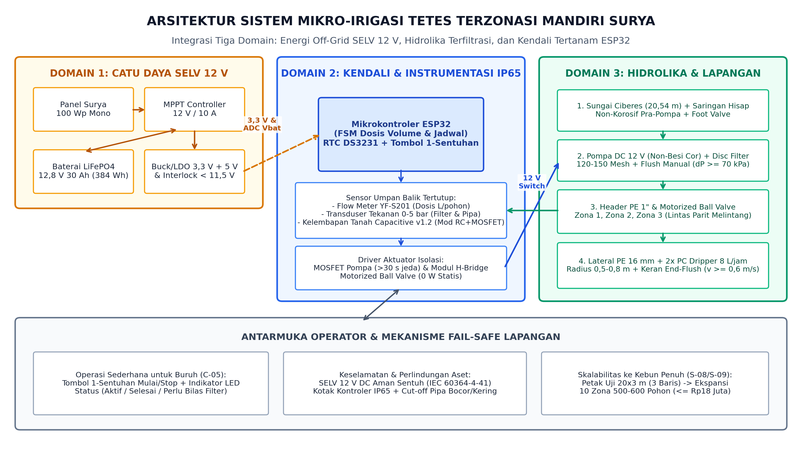
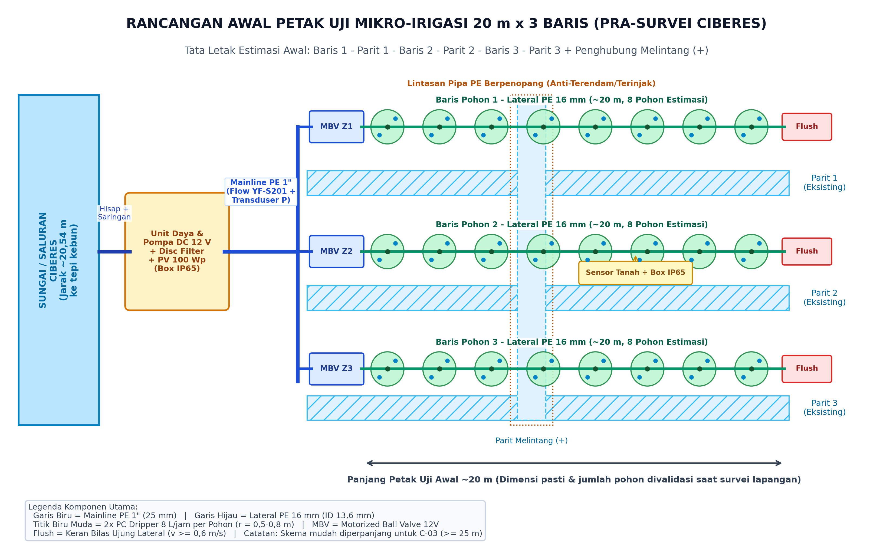

# Catatan Paparan & Penjelasan Solusi Detail untuk Mitra Kebun Jeruk Limau Ciberes

**Tanggal Pembaruan:** 14 November 2026  
**Disusun untuk Diskusi Lapangan Tim Capstone S1 Teknik Komputer — Universitas Telkom bersama Pengelola/Pemilik Kebun Ciberes**  
*Rujukan Desain Teknis: [CD3_Jeruk_Limau_Usulan.pdf](../dokumen/draf/cd3_daffa/CD3_Jeruk_Limau_Usulan.pdf) · [Tabel_Perbandingan_Alternatif_Solusi.pdf](../dokumen/draf/cd3_daffa/Tabel_Perbandingan_Alternatif_Solusi.pdf) · [Kajian Sumber Air Irigasi & Pompa](KAJIAN_SUMBER_AIR_IRIGASI_DAN_POMPA.md)*

---

## 1. Masalah Utama yang Kami Tangkap & Target Bersama Mitra

Dari kunjungan, rekaman wawancara, foto parit, dan diskusi sebelumnya, tim merangkum persoalan inti penyiraman di kebun jeruk limau Ciberes (`~500–600 pohon`, 3 parit galian tanah `~100 m` dengan penghubung melintang `+`, tanpa sambungan listrik PLN) ke dalam empat poin berikut:

1. **Pemberian air tahap akhir ke pohon (*last-mile*) masih manual:** Pompa sudah menaikkan air ke parit, tetapi buruh tetap harus menimba dengan ember hitam kecil lalu mengguyur satu per satu ke tiap pohon.
2. **Volume air belum terukur pasti terhadap acuan `15 Liter/pohon`:** Belum ada meteran/pengukur pasti berapa liter air yang benar-benar sampai ke akar setiap pohon (terutama ketika parit mulai dangkal atau air parit surut setelah pompa berhenti).
3. **Biaya berulang tenaga kerja & perawatan pompa:** Upah penyiraman **`4 pekerja × Rp100.000 = Rp400.000/kegiatan`** (jika kemarau rutin 3 hari sekali, skenario upahnya bisa mencapai **`~Rp4 juta/bulan`** atau **`~Rp48,7 juta/tahun`** di luar biaya rutin BBM bensin **Pertalite** serta perawatan pompa Alkon — termasuk pengalaman uji coba konversi **LPG 3 kg** terdahulu yang terpaksa dihentikan karena mesin cepat panas/*overheating* dan mempercepat aus seher/ring).
4. **Target Mitra:** Menggantikan pekerjaan timba-guyur manual agar **biaya total operasional penyiraman turun nyata**, air per pohon **lebih terjamin dan seragam**, sistem **mandiri tanpa PLN**, serta **mudah dijalankan pekerja kebun**.

---

## 2. Mengapa Kami Mengkaji 4 Alternatif Solusi? (Perbandingan Terbuka untuk Mitra)

Sebelum menentukan desain terbaik, tim mengkaji **empat konsep teknologi berbeda** berdasarkan literatur teknik, kondisi parit & tanah Ciberes, serta kesepakatan batasan desain (`CD-2`: purwarupa uji mahasiswa maksimal **Rp5 juta**, perkiraan instalasi kebun penuh maksimal **Rp18 juta**, aman sentuh DC, tanpa emisi asap/oli di sekitar pohon):

| Opsi Solusi yang Dikaji | Gambaran Cara Kerja | Keunggulan | Mengapa Cocok / Tidak Cocok di Kebun Ciberes? *(Skor Evaluasi 1–5)* |
|---|---|---|---|
| **Opsi 1 (USULAN TERPILIH): Sistem Mikro-Irigasi Tetes Terzonasi Surya** | Pipa tetap menyalurkan air sungai yang sudah disaring langsung ke pangkal tiap pohon lewat **2 tetesan terukur (dripper)** berpompa DC tenaga surya + **katup listrik per zona/baris**, dikontrol **1 tombol**. | Dosis tepat **15 L/pohon** terukur flow meter; bebas guyur manual; hemat air (>80% langsung ke akar); nol asap/BBM; pipa mudah melintasi parit silang `+`; masuk pagu biaya. | **Skor Tertinggi: `4,75 / 5,00` (PALING LAYAK).** Satu-satunya opsi yang menuntaskan akar masalah *last-mile*, masuk pagu purwarupa (`Rp4,85 juta`) & skala penuh (`Rp17,79 juta`), serta aman dari lumpur dan banjir asalkan filter & keran bilas dipasang benar. |
| **Opsi 2 (DITOLAK): Robot Beroda/Perayap Otonom & Robot Pengangkang Parit (*Straddle Ditch-Rover*)** | Robot berjalan sendiri menyusuri barisan atau mengangkangi parit sambil membawa tangki air atau pipa isap parit apung + lengan penyemprot ke arah akar. | Tidak perlu bentang pipa panjang di sepanjang kebun; tampak canggih secara navigasi otomatis. | **Skor Terendah: `1,70 / 5,00` (TIDAK LAYAK).** (1) **Terbenam/selip & longsor parit:** riset pada tanah basah kadar air ~35% menunjukkan roda selip `10%` dan perayap (*track*) selip `3%`; sasis robot `25–35 kg` di tanah galian basah berisiko melongsorkan bibir parit `+` serta tersangkut dahan rendah `~1 m`. (2) **Terlalu lambat:** robot bertangki `~50 kg` habis tiap `2–3 pohon`, sedangkan konsep pompa mikro `5,11 L/mnt` butuh **`~30 jam nonstop`** untuk `600 pohon`. (3) **Baterai & Biaya membengkak:** operasi 8 jam butuh baterai besar `~3,69 kWh`; purwarupa pengangkang parit estimasinya sudah **`Rp7,5–8,5 juta`**, sedangkan robot AI/LiDAR pabrikan mencapai **`> Rp25–60 juta`**. (4) Belum ada bukti riset teruji bahwa pipa isap apung di parit tanah berlumpur tidak cepat macet saat parit surut. |
| **Opsi 3 (DITOLAK): Robot Penarik Selang 100 m / Pengangkang Saluran Mesin BBM + *Spray Gun*** | Mesin berjalan di jalur kebun sambil menarik selang panjang `100–120 m`, atau mesin diesel pengangkang parit lurus yang menyemprot jarak jauh (*spray gun*). | *Nozzle* semprot besar relatif tahan kotoran kasar. | **Skor: `1,85 / 5,00` (TIDAK LAYAK).** (1) **Beban tarik selang sangat berat:** hitungan hidrolika & gesek tanah sepanjang `120 m` menghasilkan gaya tarik **`316–502 N`** (berat selang penuh air `49,5–78,7 kg`) untuk selang 3/4"–1", sedangkan selang 1/2" kehilangan tekanan ekstrem `20,38 bar`. (2) **Boros air & merusak daun:** *gun* menyemprot radius `47–75 m` sehingga membasahi daun/tajuk (risiko penyakit jamur/busuk) dan airnya banyak terbuang kembali ke parit. (3) **Gagal di parit silang `+` & berisik/boros BBM:** mesin pengangkang kanal butuh saluran beton lurus dan rawan jatuh di persimpangan `+`, sementara mesin bensin `7 HP` / diesel mengulang keluhan perawatan & asap di kebun. |
| **Opsi 4 (CADANGAN KONSEP): Menara Tandon Gravitasi atau Gerobak Pompa Surya** | Pompa surya mengisi tangki tandon tinggi `2–4 m` (lalu mengalir gravitasi) atau memakai **gerobak dorong** berisi aki + panel surya `50 Wp` + selang manual. | Gerobak PV murah (`~Rp2,7–4 juta`) & tanpa BBM; konsep mudah dipahami. | **Skor: `3,15 / 5,00` (CADANGAN / KURANG OPTIMAL).** Gerobak dorong tidak menghilangkan tenaga kerja menarik selang melompati 3 parit dan tidak menakar `15 L` otomatis. Sementara menara tandon `8–10 m³` berat untuk seluruh kebun mahal (`> Rp12–22 juta`), berisiko amblas di tanah sawah lunak, dan tekanannya turun (`< 0,3 bar`) sehingga pohon di ujung baris dapat air jauh lebih sedikit. |

---

## 3. Penjelasan Detail Solusi Usulan: Sistem Mikro-Irigasi Tetes Terzonasi Surya (Alternatif 1)

Solusi terpilih ini bekerja seperti **jaringan pipa ledeng terukur di tingkat akar pohon**, namun seluruh pompa, katup, dan otaknya ditenagai **matahari 100%**. Agar mitra mendapat gambaran menyeluruh, berikut rincian teknis tiap bagian sistem yang dirancang tim:

### 3.1 Alur Air dari Sungai ke Akar Pohon & Penanganan Lumpur Ciberes
Air sungai di Ciberes membawa pasir halus dan lumpur yang mudah menyumbat selang tetes biasa. Oleh karena itu, sistem kami memakai **4 lapis pengaman anti-mampat**:
1. **Lapisan 1 — Saringan Hisap Kasar + *Foot Valve* di Sungai:** Menyaring daun, ranting, dan pasir kasar (`1–2 mm`) di ujung pipa hisap sebelum masuk ke pompa, sekaligus menjaga air tetap di pipa agar pompa mudah menyedot.
2. **Pompa Diafragma DC 12 V Non-Besi Cor:** Memakai rumah pompa polimer/tahan karat (bukan besi cor) berdaya `~80–100 W`. Tekanan kerjanya menjaga jaringan di atas `~1,0–1,4 bar` saat menyiram bersih.
3. **Lapisan 2 — *Disc Filter* 120–150 Mesh (`±124 mikron`) + Keran Bilas:** Menahan partikel pasir halus/debu sungai. Dilengkapi **sensor tekanan elektronik (`0–5 bar`)**: jika saringan mulai kotor (selisih tekanan naik `>= 0,7 bar` / `70 kPa`), lampu indikator kuning akan menyala memberi tahu pekerja untuk membuka keran bilas filter selama `< 1 menit`. Sensor tekanan ini juga langsung **mematikan pompa otomatis** jika sungai kering (*dry-run*) atau pipa utama bocor parah.
4. **Pembagi Zona (*Motorized Ball Valve* / MBV 12 V):** Alih-alih memakai katup selenoid biasa yang terus-menerus memakan listrik dan kawatnya cepat berkarat di tempat lembap, sistem memakai **katup bola bermotor (MBV)**. Katup ini hanya menyedot daya `~4 W` selama **5 detik saat membuka/menutup**, lalu **0 W saat diam terbuka** — menghemat **99,9% daya katup** dibanding selenoid biasa, serta berlubang penuh (*full-bore*) sehingga kotoran halus tidak tersangkut di katup.
5. **Pipa Utama (`1 inci`) + Pipa Lateral (`PE 16 mm`) + Penopang Parit Melintang (`+`):** Pipa dibentangkan di pangkal baris dan melewati parit penghubung melintang `+` memakai **penopang pipa sederhana (jembatan pipa)** agar tidak terendam air parit maupun terinjak pekerja saat menyiang gulma.
6. **Lapisan 3 — 2 Buah *PC Dripper (Pressure Compensating) 8 L/jam* per Pohon:**
   - Mengapa *PC Dripper*? Karena emiter ini punya pengatur tekanan di dalamnya: selama tekanan air minimal `~0,78–1,0 bar`, pohon terdekat dan pohon paling jauh tetap mengeluarkan **`8 L/jam` per tetes (`16 L/jam/pohon`) secara merata** (`keseragaman CU >= 85%`).
   - Dua penetes dipasang di kanan-kiri pangkal batang pada radius **`0,5–0,8 m`** (tepat di zona akar aktif, **tanpa membasahi daun/batang** sehingga aman dari jamur busuk akar/*Phytophthora*).
   - **Durasi penyiraman terhitung (skala uji):** Karena `2 × 8 L/jam = 16 L/jam`, maka menyalurkan acuan mitra **`15 Liter/pohon`** selesai dalam **`56 menit 15 detik`**.
   - **Pengukuran Liter Nyata:** Di jalur utama dipasang **Water Flow Meter `YF-S201`** (akan dikalibrasi pakai ember/gelas ukur). Jadi pompa menutup katup berdasarkan **jumlah liter nyata yang sudah mengalir**, bukan sekadar kira-kira menit!
7. **Lapisan 4 — Keran Bilas Ujung (*End-Flush Valve*) di Tiap Ujung Baris:**
   - Selama menetes pelan (`128–384 L/jam`), kecepatan air di dalam pipa cuma `~0,245 m/s` (di bawah batas pengendapan lumpur `0,60 m/s` menurut literatur teknik irigasi).
   - Solusinya: di setiap ujung pipa baris `16 mm` dipasang **keran *end-flush* manual**. Saat dibuka bergiliran satu zona saja (`mode bilas`), air mengalir deras hingga **`0,80 m/s >= 0,60 m/s`** sehingga lumpur halus yang sempat mengendap di ujung pipa langsung tersapu keluar dalam hitungan 1–2 menit!

### 3.2 Listrik Mandiri Tenaga Surya (100% Bebas PLN, BBM, & Aman Sentuh)
- **Tegangan Aman Sentuh (`12,8 V DC` SELV):** Sama aman seperti aki motor/mobil (`<= 48 V DC` sesuai standar keselamatan listrik ruang basah), jadi pekerja tidak berisiko tersengat listrik di kebun basah.
- **Panel Surya `100 Wp` + MPPT `10 A` + Baterai `LiFePO4 12,8 V 30 Ah` (`384 Wh`):**
  - Baterai **LiFePO4** dipilih (bukan aki asam timbal biasa) karena awet ribuan siklus, aman dipakai hingga 80% kapasitas (`307,2 Wh`), dan tidak gampang soak.
  - **Hasil Simulasi Awal Neraca Energi (pra-survei, 24 pohon / `360 L` per siklus):**
    - Hari cerah: panel `100 Wp` memanen **`~332 Wh/hari`**; bahkan hari mendung berat memanen **`~110,7 Wh/hari`**.
    - Konsumsi 1 siklus penuh (3 baris serentak) hanya **`~85,72 Wh`** (atau `~188,79 Wh` jika bergiliran 3 zona + tidur 71 jam).
    - Jika baterai terisi penuh, tanpa sinar matahari sama sekali sistem mampu menyokong **`~3,58 siklus` serentak (setara `~10,8 hari` untuk jadwal 3 hari sekali)**, atau **`~1,63 siklus` zona bergantian (`~4,9 hari`)**.
- **Ketahanan Cuaca Kebun (`Kotak Panel IP65`):** Seluruh modul elektronik masuk boks kedap air & debu (`IP65`), mengutamakan **pengukur liter nyata (*Flow Meter*) + 1 tombol tunggal**, dan secara **opsional** dapat dilengkapi `1–2` sensor kelembapan tanah *Capacitive v1.2* (dilapisi pelindung tahan air) bila mitra menginginkan penundaan siram otomatis seusai hujan lebat.

### 3.3 Kemudahan Pemakaian bagi Pekerja Kebun (`1 Tombol`)
Pekerja kebun tidak perlu memakai HP atau mengerti pemrograman:
- **Mode Otomatis Terjadwal:** Sistem bangun otomatis sesuai jadwal (misal tiap 3 hari sekali jam 06.30 WIB), lalu (jika fitur tunda-hujan dipilih) mengecek apakah tanah masih basah oleh hujan; bila kering, sistem menyiram tepat `15 L × jumlah pohon` tiap zona lalu kembali tidur hemat daya.
- **Mode Manual (`Tombol 1-Sentuhan`):** Jika pekerja/pemilik ingin langsung menyiram kapan saja di luar jadwal, cukup tekan **1 tombol tahan air** di kotak kontrol.
- **Tiga Lampu Indikator Sederhana:**
  - **Lampu Hijau:** Siap / Sedang menyiram normal / Selesai.
  - **Lampu Kuning:** Saringan *disc filter* mulai kotor -> buka keran bilas saringan & keran *end-flush* sebentar (`<= 15–20 menit/bulan`).
  - **Lampu Merah:** Ada gangguan (air sungai surut/pompa kering, pipa pecah/bocor, atau baterai lemah) -> pompa otomatis mati aman.

---

## 4. Rencana Bertahap: Purwarupa Petak Uji (Biaya Tim) vs Skala Kebun Penuh (Investasi Mitra)

Penting bagi mitra untuk membedakan secara jelas antara **Purwarupa Uji Coba Mahasiswa** dan **Rancangan Skala Kebun Penuh**:

### Tahap A — Purwarupa Fungsional di Petak Uji (`~20–25 m × 3 Baris`, Dibiayai Tim Mahasiswa)
Sesuai aturan proyek Capstone Universitas Telkom (`IABEE`), tim mahasiswa membangun **1 unit purwarupa uji** di sebagian petak kebun mitra untuk membuktikan keandalan alat langsung di tanah Ciberes (`CU >= 85%`, dosis akurat `15 L ± 5%`, uji sedimen, dan uji kemudahan buruh). **Peralatan purwarupa ini tidak dibebankan ke mitra.**

*Model awal sebelum pengukuran detail Minggu ini: `20 m × 3 baris` (~24 pohon contoh), dapat disesuaikan panjangnya pasca-survei Minggu agar memenuhi syarat bentang uji `C-03` (`>= 25 m` / `15–20 pohon`).*

**Rincian Perkiraan Komponen Fisik Purwarupa (`17 Item BOM = Rp4.850.000`, di bawah pagu Rp5 Juta):**

| Kelompok Komponen | Rincian Barang & Spesifikasi | Perkiraan Biaya |
|---|---|---:|
| **PLTS & Baterai Off-Grid** | Panel Surya `100 Wp` + MPPT `10 A` + Baterai `LiFePO4 12,8 V 30 Ah + BMS` | Rp2.020.000 |
| **Pompa & Saringan Sungai** | Saringan hisap + *Foot Valve* non-korosif (`1"`), Pompa Diafragma DC `12 V 80–100 W` polimer, *Disc Filter* `120–150 mesh` + keran bilas | Rp600.000 |
| **Katup Zona & Kendali Otomatis** | `3× Motorized Ball Valve 12 V 3/4"`, `Driver H-Bridge & MOSFET`, `ESP32 + RTC DS3231 + LDO 3,3 V`, Kotak IP65 + Tombol + 3 LED + Sekring `15 A` | Rp1.045.000 |
| **Sensor Ukur & Anti-Hujan** | *Flow meter* `YF-S201`, Transduser Tekanan `0–5 bar`, `2×` Sensor Tanah *Capacitive v1.2* modifikasi anti-korosi | Rp380.000 |
| **Jaringan Pipa & Penetes** | Pipa Utama PE `1"` (`31 m`), Lateral PE `16 mm` (`65 m`), `50× PC Dripper 8 L/jam`, `3×` keran *end-flush* + tee + penyangga jembatan parit `+` | Rp805.000 |
| **TOTAL BELANJA ALAT PURWARUPA** | **Alat fisik fungsional terpasang di petak uji Ciberes** | **Rp4.850.000** |

*(Catatan transparan tim: di luar komponen alat di atas, tim menganggarkan `Rp1.585.000` untuk alat ukur laboratorium/uji lapangan seperti gelas ukur & TDS meter, lem/kabel gland, rangka tiang panel, dan ongkos survei Bandung–Subang sehingga total RAB penelitian mahasiswa adalah `Rp6.435.000`.)*

---

### Tahap B — Proyeksi Ekspansi ke Seluruh Kebun Penuh (`500–600 Pohon`)
Jika petak uji terbukti berhasil, sistem ini bersifat **modular** — pipa, katup, dan kapasitas surya tinggal diperbanyak melayani seluruh populasi kebun. Tabel di bawah adalah **ilustrasi awal draf** (`Rp17,79 juta`, di bawah batas `Rp18 juta` pada `CD-2`); **jumlah zona final (`rekomendasi teknik: ~4 zona` @ pompa `~33–40 L/menit` agar seluruh kebun tuntas `<= 4 jam`) akan disesuaikan setelah jumlah pohon & baris riil disensus hari Minggu**:

| Kelompok Ekspansi Kebun Penuh *(Ilustrasi Awal Draf 10 Zona — Disesuaikan Pasca-Sensus)* | Spesifikasi Peningkatan | Proyeksi Biaya |
|---|---|---:|
| **PLTS Utama Kebun** | `2× Panel Surya 150 Wp` + `MPPT 30 A` + `LiFePO4 100 Ah` | Rp5.450.000 |
| **Pompa & Pra-Filter Kapasitas Penuh** | Pompa `DC/BLDC 24 V` atau `2× Pompa DC 12 V` Paralel (`~960 L/jam @ 1,5–2 bar`) + Pra-filter | Rp1.950.000 |
| **10 Katup Zona Otomatis** | `10× Motorized Ball Valve PTFE` + ekspansi modul isolasi driver | Rp1.850.000 |
| **Pipa Utama & Jembatan Parit Penuh** | *Mainline* `HDPE 1,5 inci (140 m)` + penopang lintas parit `+` | Rp2.150.000 |
| **Pipa Lateral & Keran Bilas Penuh** | Lateral `PE 16 mm (~600 m)` + keran *end-flush* di ujung tiap zona | Rp2.250.000 |
| **Emiter Penetes 600 Pohon** | `1.200 unit PC Dripper 8 L/jam` (2 per pohon) + selang mikro | Rp2.760.000 |
| **Kontroler Pusat & Filtrasi Ganda** | Master `ESP32` + *Disc Filter* ganda `120 mesh` + sensor tekanan, flow, & 4 sensor tanah | Rp1.380.000 |
| **TOTAL PROYEKSI SKALA PENUH (600 POHON)** | **Masuk batas target kelayakan CD-2 `<= Rp18.000.000`** | **Rp17.790.000** |

### Gambaran Hitungan Ekonomis & Titik Impas (*Skenario Bersyarat — Akan Dikalibrasi Pasca-Survei*)
* **Kondisi Saat Ini (Upah saja, skenario 3 hari sekali tetap):** `Rp400.000/siklus` = **`~Rp4.000.000/bulan`** (kemarau ~10 siklus) atau **`~Rp48,7 juta/tahun`** — *angka ini belum termasuk biaya rutin bensin Pertalite serta servis pompa Alkon*.
* **Kondisi Setelah Memakai Sistem Surya Skala Penuh:** Biaya listrik = **`Rp0`** (tenaga surya), tidak ada konsumsi bensin Pertalite maupun gas/oli mesin, yang tersisa hanya biaya pemeliharaan berkala saringan/pengecekan (`target OPEX <= Rp50.000/siklus`).
* **Perkiraan Balik Modal (*Payback Period*):** Secara hitungan bersyarat, penghematan bersih upah berkisar `~Rp3,5 juta/bulan` di musim penyiraman rutin (`>= Rp42 juta/tahun` bila interval 3 hari berjalan penuh), sehingga investasi penuh **`Rp17.790.000`** secara matematis berpotensi impas dalam **`< 1 tahun`** (`~4–6 bulan` bila penyiraman berlangsung rutin setiap 3 hari). **Angka final baru akan ditetapkan setelah data biaya BBM/servis pompa dan alokasi peran pekerja kami konfirmasi langsung dengan mitra pada survei Minggu ini.**

---

## 5. Poin Penting yang Kami Mohon Kesepakatan Bersama Mitra Hari Minggu Ini

Agar sistem yang tim rakit di Bandung benar-benar cocok dan aman saat dipasang di Ciberes, berikut **6 hal yang akan kami konfirmasi langsung di lokasi**:

1. **Penentuan Petak Uji (`1 lokasi × 3 baris`):** Bersama pemilik/pengurus menentukan petak mana (`~20–25 m × 3 baris`) yang diizinkan untuk pemasangan alat uji purwarupa tanpa mengganggu panen/kerja kebun.
2. **Keamanan & Penempatan Alat:** Apakah di kebun ada tempat/cara paling aman meletakkan tiang panel surya + kotak baterai (anti banjir & anti pencurian/hewan), dan apakah pipa baris `16 mm` aman dipasang melingkar di piringan akar atau digantung `15 cm` di ajir agar tidak terkena cangkul/mesin babat.
3. **Konfirmasi Target Dosis `15 L/pohon`:** Apakah seluruh pohon (`~1 m` maupun yang lebih tinggi/berbuah) sementara disamaratakan ke acuan mitra `15 L/pohon`, atau ada blok pohon besar yang menurut mitra butuh volume berbeda.
4. **Peran Pekerja Kebun:** Memastikan bagaimana tugas pekerja eksisting setelah penyiraman diguyur manual tidak lagi dikerjakan (tetap membantu bilas filter `< 20 mnt/bln`, tekan tombol, serta dialihkan ke perawatan tanaman/panen).
5. **Izin Bawa Sampel Air & Tanah + Audit Pompa:** Izin mengambil `~1–2 kg` sampel tanah liat zona akar dan `1–2 botol` sampel air sungai/parit untuk kalibrasi sensor & saringan di lab, mencatat konsumsi Pertalite riil & nota/riwayat perawatan pompa Alkon (termasuk cerita saat dulu menguji LPG), serta menyepakati cara pemasangan selang hisap dalam kurungan penahan arus di tepi saluran irigasi (atau opsi cadangan kolam terpal bila saluran digilir kering).
6. **Pencantuman Identitas & Persetujuan Kunjungan:** Konfirmasi nama pengelola/kebun yang bersedia dicantumkan pada dokumen akademik Capstone Universitas Telkom beserta tanda tangan/paraf **Berita Acara Survei Mitra**.
